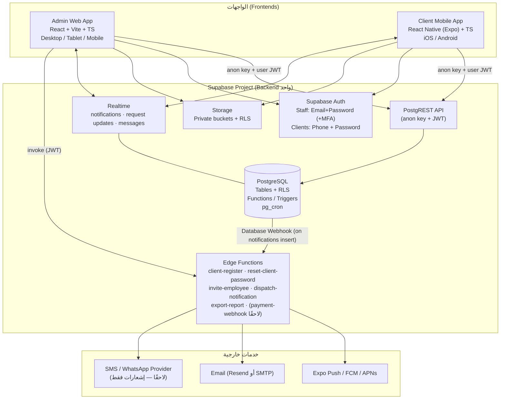
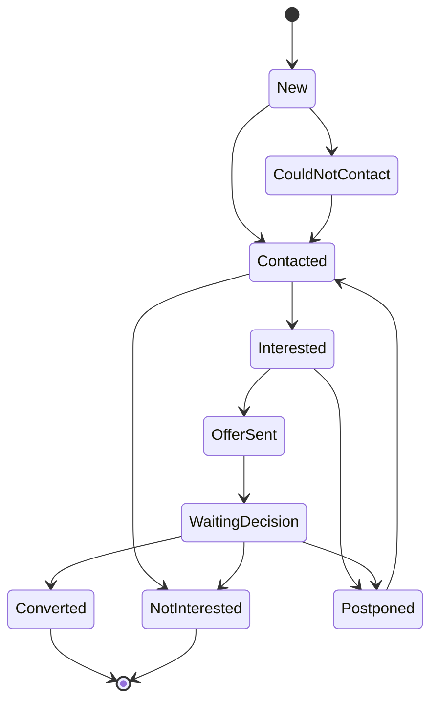
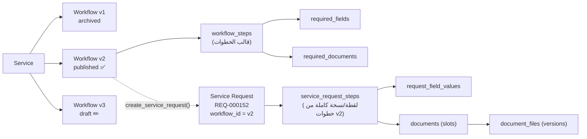
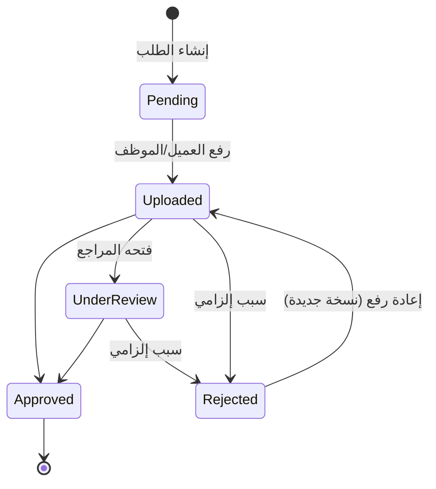
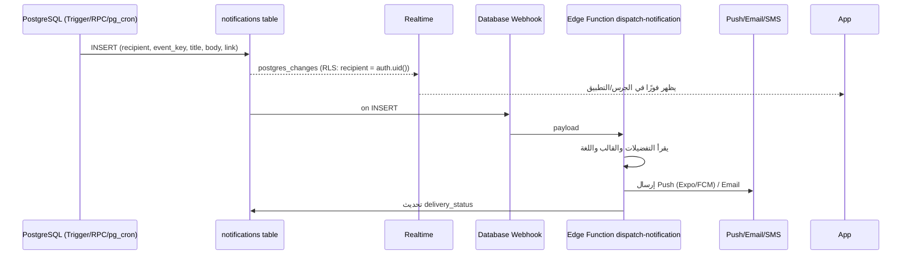
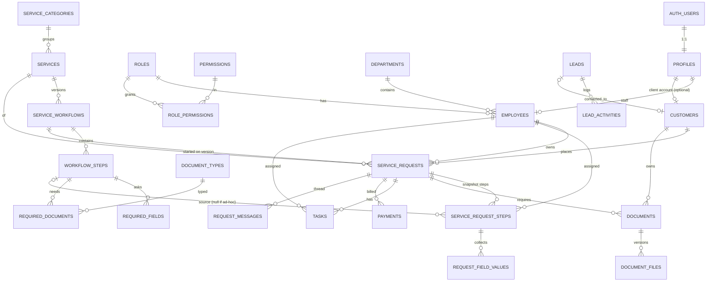
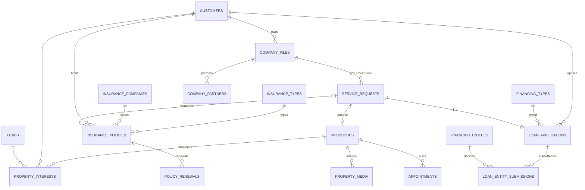

# SSO — Sara Soliman · خطة المنتج والمعمارية

> **نظام إدارة متكامل** لشركة تعمل في: التسويق العقاري · التأمين · تأسيس الشركات وتخليص الأوراق الحكومية · القروض التجارية
>
> **الإصدار:** 1.1 · **التاريخ:** 8 أكتوبر 2026 · **الحالة:** تخطيط وتصميم فقط (لا يوجد تنفيذ)
>
> **التغييرات في 1.1 (قرارات صاحب المشروع):** تسجيل العميل من التطبيق (الاسم الرباعي + الرقم القومي + الهاتف + كلمة السر) والدخول بالهاتف + كلمة السر · استعادة كلمة السر من الإدارة فقط · اعتماد Expo لتطبيق العميل · الشركة **وسيط لتخليص الأوراق** فقط (ليست جهة تأمين ولا إقراض) · قرار التخزين: Supabase Storage للمستندات الرسمية وليس Cloudinary (القسم 9.4).
>
> **ملفات مرافقة:** `SYSTEM_PRODUCT_DESIGN.pptx` (العرض البصري) · `SYSTEM_PRODUCT_DESIGN.pdf` (نفس العرض بصيغة PDF عالية الدقة)

---

## فهرس

0. [فحص المشروع الحالي](#0-فحص-المشروع-الحالي)
1. [Executive Summary](#1-executive-summary)
2. [Product Vision](#2-product-vision)
3. [System Architecture](#3-system-architecture)
4. [Admin System](#4-admin-system)
5. [Client App](#5-client-app)
6. [CRM](#6-crm)
7. [Services](#7-services)
8. [Dynamic Workflow Engine](#8-dynamic-workflow-engine)
9. [Documents](#9-documents)
10. [Tasks](#10-tasks)
11. [Notifications](#11-notifications)
12. [Roles & Permissions](#12-roles--permissions)
13. [Database Architecture](#13-database-architecture)
14. [Supabase Architecture](#14-supabase-architecture)
15. [Security](#15-security)
16. [UX/UI](#16-uxui)
17. [Responsive Strategy](#17-responsive-strategy)
18. [Reports](#18-reports)
19. [Audit Logs](#19-audit-logs)
20. [Development Phases](#20-development-phases)
21. [MVP Scope](#21-mvp-scope)
22. [Future Enhancements](#22-future-enhancements)
23. [Risks](#23-risks)
24. [Technical Decisions](#24-technical-decisions)
25. [Acceptance Criteria](#25-acceptance-criteria)
26. [ملحق: تحليل المتطلبات — تعارضات ونقاط ناقصة](#26-ملحق-تحليل-المتطلبات--تعارضات-ونقاط-ناقصة)
27. [ملحق: قرارات مطلوبة من صاحب المشروع](#27-ملحق-قرارات-مطلوبة-من-صاحب-المشروع)

---

## 0. فحص المشروع الحالي

| البند | النتيجة |
|---|---|
| بنية المشروع | المجلد يحتوي على ملف واحد فقط: `logo.jpg` (1536×1024 تقريبًا، ~128KB). لا يوجد كود، لا `package.json`، لا Git، لا إعدادات Supabase. |
| التصنيف | **Greenfield Project** — سيتم بناء كل شيء من الصفر، ولا يوجد كود قائم يمكن أن يتعارض مع المعمارية المقترحة. |
| الـLogo | `logo.jpg` — شعار **SSO** بحروف 3D باللون الكحلي مع شريط (Ribbon) أزرق سماوي يمر عبر الحروف، وداخل حرف O رسم مبانٍ (يرمز للعقارات والنمو)، وتحته **SARA SOLIMAN** بخط Sans هندسي بين خطين أزرقين. الخلفية بيضاء. |
| Brand Guidelines | غير موجودة. لا توجد ملفات ألوان أو خطوط. |
| Fonts | غير موجودة. خط الـLogo اللاتيني قريب من عائلة Montserrat (Geometric Sans). |
| ملاحظة على الـLogo | الملف JPG بخلفية بيضاء وبتأثيرات 3D وظلال، لذلك: (1) يُستخدم على خلفيات فاتحة فقط، (2) يُنصح لاحقًا بالحصول على نسخة **SVG/PNG شفافة** ونسخة **أحادية اللون (أبيض)** ونسخة **أيقونة مربعة (SSO فقط)** للـApp Icon والـFavicon — دون تغيير التصميم نفسه. |

### الألوان المستخرجة من الـLogo (عينات فعلية من البكسلات)

| الدور | اللون | المصدر في الـLogo |
|---|---|---|
| **Primary — Navy** | `#0B2A55` | جسم حروف SSO ونص SARA SOLIMAN (`#01214F` / `#09274D`) |
| **Secondary — Royal Blue** | `#0057E6` | الوجه الأزرق للمبنى (`#004EE6`) |
| **Accent — Sky Blue** | `#22A0F5` | الشريط السماوي والمبنى الفاتح (`#209CF4`) |
| Line Blue (مساعد) | `#0177D0` | الخطوط الجانبية حول الاسم |
| Background | `#F4F7FB` | تدرج بارد قريب من خلفية الـLogo البيضاء |
| Surface | `#FFFFFF` | |
| Text Primary | `#0F1E36` | كحلي داكن جدًا متناسق مع الـPrimary |
| Text Secondary | `#5B6B84` | |
| Border | `#E3E9F2` | |

ألوان الحالات (Semantic) مختارة لتتناسق مع العائلة الزرقاء: Success `#12A150` · Warning `#E8A317` · Danger `#D93B3B` · Info `#22A0F5`.

---

## 1. Executive Summary

نقترح بناء منصة واحدة على **Supabase** (PostgreSQL + Auth + Storage + Realtime + Edge Functions) تخدم واجهتين منفصلتين:

1. **Admin Management System** — تطبيق ويب (Desktop-first وResponsive فعليًا على Tablet وMobile) لإدارة العملاء والـLeads والخدمات والطلبات والمهام والمستندات والمدفوعات والتقارير والصلاحيات.
2. **Client Mobile App** — تطبيق موبايل للعملاء (iOS/Android) لطلب الخدمات ومتابعتها ورفع البيانات والمستندات واستقبال الإشعارات.

**قلب النظام هو Dynamic Service & Workflow Engine**: الخدمات وخطواتها والبيانات والمستندات المطلوبة في كل خطوة كلها **بيانات (Data) وليست كودًا**. الـSuper Admin يبني ويعدّل الخدمات من لوحة التحكم. كل Workflow له **إصدارات (Versions) غير قابلة للتعديل بعد النشر**، وكل طلب (Service Request) **يحتفظ بلقطة (Snapshot) من خطوات الإصدار الذي بدأ عليه**، فلا تتأثر الطلبات الجارية بأي تعديل مستقبلي.

**لا يوجد Backend منفصل** (NestJS/Express): كل منطق الأعمال الحساس يعيش في PostgreSQL (Functions + Triggers + RLS)، والتكاملات الخارجية (Push/Email/SMS، دعوة الموظفين، التصدير الثقيل) في Edge Functions. لم نجد سببًا معماريًا يبرر Backend منفصلًا في هذا النطاق (راجع [القسم 24](#24-technical-decisions)).

**التنفيذ في 8 مراحل**. الـMVP = المراحل 1–5 + أساسيات المرحلة 7 (إشعارات داخلية + Push، تسجيل مدفوعات يدوي، Dashboard أساسي). النقطة الذكية في الترتيب: **محرك الـWorkflow العام يغطي الخطوط الأربعة كخدمات من اليوم الأول**، بينما الوحدات المتخصصة (مخزون العقارات، سجل الوثائق وتذكير التجديد، تفاصيل طلب القرض) تأتي في المرحلة 6 فوق نفس المحرك.

---

## 2. Product Vision

> **"كل خدمة تقدمها SSO — من حجز اسم شركة إلى تجديد وثيقة تأمين — تُدار كمسار واضح، يعرف فيه الموظف ما المطلوب منه اليوم، ويعرف فيه العميل أين وصل طلبه وما الذي ينقصه، دون مكالمة واحدة للاستفسار."**

### الأهداف

| الهدف | المؤشر (KPI) |
|---|---|
| شفافية كاملة للعميل | ≥ 70% من استفسارات "وصل طلبي لفين؟" تختفي بعد 3 أشهر من الإطلاق |
| تقليل زمن إنجاز الطلب | قياس متوسط زمن كل خطوة ومقارنته بالـSLA المحددة في الـWorkflow |
| عدم ضياع أي Lead | 100% من الـLeads لها مسؤول وموعد متابعة قادم أو حالة نهائية |
| مرونة تشغيلية | إضافة خدمة جديدة أو خطوة جديدة **بدون مطور وبدون Deployment** |
| حوكمة | كل تغيير حساس مسجل في Audit Log (من/ماذا/متى/قبل/بعد) |

### المستخدمون (Personas)

| Persona | الواجهة | الاحتياج الأساسي |
|---|---|---|
| Super Admin (صاحبة الشركة / مدير النظام) | Admin | بناء الخدمات، الصلاحيات، رؤية كل شيء |
| Manager | Admin | متابعة أداء الفريق، الطلبات المتأخرة، الاعتمادات |
| Sales | Admin (غالبًا Mobile/Tablet في الميدان) | الـLeads، المتابعات، المعاينات العقارية |
| Operations | Admin | تنفيذ خطوات الطلبات، مراجعة المستندات، الجهات الحكومية |
| Accountant | Admin | المدفوعات والمستحقات |
| Employee | Admin | مهامه اليومية فقط |
| Client (فرد أو شركة) | Client App | طلب خدمة، رفع مستندات، متابعة |

### ما ليس ضمن الرؤية (Non-goals) في الإصدار الأول
- ليس نظام محاسبة كامل (لا قيود يومية ولا ميزانية) — فقط مدفوعات ومستحقات للطلبات.
- ليس بوابة عقارية عامة (Listing Portal) للجمهور — العقارات تُدار داخليًا (قابل للتوسع لاحقًا).
- لا ميزات AI (حسب التوجيه).
- لا Workflow شرطي متفرع (Branching) في الـMVP — المخطط يدعمه مستقبلًا دون إعادة تصميم.

---

## 3. System Architecture



### مبادئ المعمارية

1. **Backend واحد، واجهتان منفصلتان.** نفس قاعدة البيانات ونفس الـAuth. الفصل بين Staff وClient يتم بـ`profiles.user_type` + RLS، وليس بقاعدتي بيانات.
2. **الـDatabase هي مصدر الحقيقة والمنطق.** انتقالات الـWorkflow، إنشاء الطلبات، تحويل الـLead، التحقق من المستندات — كلها **Database Functions (RPC)** تُنفذ في Transaction واحدة وتحترم الصلاحيات. هذا يضمن أن الواجهتين تتصرفان بنفس القواعد.
3. **Edge Functions فقط لما لا تستطيعه الـDB:** استدعاء APIs خارجية، أو عمليات تحتاج Service Role (مثل دعوة موظف عبر `auth.admin`).
4. **لا Service Role Key في أي تطبيق Client.** الـAdmin والـMobile يستخدمان `anon key` + JWT المستخدم فقط. الـService Role موجود فقط داخل Edge Functions كـSecret.
5. **Configuration over Code.** الخدمات، الخطوات، الحقول، المستندات، أنواع التأمين، جهات التمويل، الأدوار والصلاحيات، قوالب الإشعارات — كلها جداول قابلة للإدارة.
6. **Immutability للإصدارات.** Workflow منشور = لا يُعدَّل. التعديل = إصدار جديد.

### هيكل المستودع المقترح (Monorepo — عند بدء التنفيذ)

```
sso-platform/
├── apps/
│   ├── admin/            # React + Vite + TypeScript (Admin Web)
│   └── client/           # Expo React Native + TypeScript (Client App)
├── packages/
│   ├── shared/           # Supabase generated types, Zod schemas, enums, i18n keys
│   ├── dynamic-forms/    # محرك عرض الحقول الديناميكية (يُستخدم في الواجهتين)
│   └── ui-tokens/        # Design tokens (ألوان/مسافات/خطوط) مشتركة
├── supabase/
│   ├── migrations/       # SQL migrations (المصدر الوحيد لتغيير الـSchema)
│   ├── functions/        # Edge Functions (Deno)
│   ├── seed.sql          # بيانات أولية: الأدوار، الصلاحيات، الخدمات النموذجية
│   └── tests/            # pgTAP tests للـRLS والـWorkflow functions
└── docs/
```

> سبب الـMonorepo: الواجهتان تتشاركان **Types** مولدة من الـSchema و**محرك النماذج الديناميكية** و**مفاتيح الترجمة**. أي تعديل في الـSchema يظهر كخطأ TypeScript في الواجهتين فورًا.

---

## 4. Admin System

### 4.1 القائمة الرئيسية (معدلة عن المقترح الأصلي)

```
الرئيسية
└── Dashboard

إدارة العملاء (CRM)
├── العملاء الحاليون (Active Customers)
├── العملاء المحتملون (Leads)            ← Pipeline (Kanban) + List
├── المتابعات (Follow-ups)
└── المواعيد (Appointments)

العمليات (Operations)
├── طلبات الخدمات (Service Requests)
├── المهام (Tasks)
└── المستندات (Documents)               ← قائمة "تحتاج مراجعة" + أرشيف

خطوط الأعمال (Business Lines)
├── التسويق العقاري                       ← Properties · Visits · Sales Pipeline
├── التأمين                               ← Policies · Renewals · Insurance Companies
├── تأسيس الشركات                          ← Company Files · Government Procedures
└── القروض التجارية                        ← Loan Applications · Financing Entities

المالية
├── المدفوعات (Payments)
└── التقارير (Reports)

الإعدادات والتهيئة (يظهر حسب الصلاحية)
├── كتالوج الخدمات (Service Builder)      ← الخدمات + التصنيفات
│   └── Workflow Builder                  ← تبويب داخل الخدمة + اختصار مباشر
├── الموظفون والأقسام (Employees)
├── الأدوار والصلاحيات (Roles & Permissions)
├── قوالب الإشعارات (Notification Templates)
├── سجل التدقيق (Audit Log)
└── الإعدادات العامة (Settings)

[في الـTopbar]  🔔 مركز الإشعارات · 🔍 بحث شامل · ➕ إنشاء سريع · الملف الشخصي
```

### أسباب التعديل

| التعديل | السبب |
|---|---|
| فصل **"خطوط الأعمال"** عن **"كتالوج الخدمات"** | في المقترح الأصلي "Services" تحتوي على الأربعة مجالات كعناصر ثابتة، وهذا يتعارض مع مبدأ الخدمات الديناميكية. الحل: **التصنيفات (Service Categories) بيانات**، والخدمات بيانات. أما "خطوط الأعمال" فهي **وحدات بيانات متخصصة** (عقارات، وثائق، ملفات شركات، طلبات قروض) لها جداولها الخاصة لأن لها بيانات لا تناسب الـWorkflow العام (مثل مساحة العقار أو تاريخ انتهاء الوثيقة). |
| دمج **Service Builder** و**Workflow Builder** تحت "كتالوج الخدمات" | الـWorkflow لا معنى له بدون خدمة. الـBuilder يفتح كتبويب داخل الخدمة، مع اختصار مستقل في القائمة كما طلبت. |
| **Notifications** في الـTopbar وليس في القائمة | الإشعارات تُستهلك من أي صفحة. القائمة تحتوي فقط على **قوالب الإشعارات** (إعدادات). صفحة "كل الإشعارات" متاحة من الجرس. |
| **Follow-ups** = نوع من الـTasks | لتجنب محركين متشابهين. Follow-up هو Task من نوع `follow_up` مرتبط بـLead أو Customer. الصفحة هي View مفلترة. |
| **Appointments** يشمل **معاينات العقارات** | المعاينة العقارية = Appointment من نوع `property_visit` مرتبط بعقار. لا جدول Visits منفصل. |
| إضافة **Audit Log** صراحة | مطلوب للحوكمة وله صلاحية مستقلة. |
| إضافة **الأقسام (Departments)** داخل Employees | مطلوبة لإسناد الخطوات لقسم، ولنطاق الصلاحيات (Scope = department). |

### 4.2 الشاشات الأساسية (25 شاشة — موضحة بصريًا في العرض)

| # | الشاشة | الهدف | أهم العناصر |
|---|---|---|---|
| 1 | Login | دخول الموظفين | Email/Password، MFA (اختياري لاحقًا للأدوار الحساسة)، نسيت كلمة المرور |
| 2 | Dashboard | "ماذا أفعل اليوم؟" + مؤشرات | KPIs، My Tasks (اليوم/متأخرة/قادمة)، طلبات متأخرة، مستندات تحتاج مراجعة، Leads جديدة، متابعات مستحقة |
| 3 | Customers List | البحث والفرز | جدول + فلاتر (النوع، الخدمة، المسؤول، الحالة)، بحث بالاسم/الهاتف/الرقم القومي، Export |
| 4 | Customer 360 | كل شيء عن العميل | Header (بيانات + KPIs)، تبويبات: نظرة عامة، الطلبات، المستندات، المدفوعات، المهام، المتابعات، المواعيد، الملاحظات، Timeline |
| 5 | Leads | إدارة الـPipeline | Kanban حسب المرحلة + عرض جدول، المصدر، المسؤول، موعد المتابعة القادم |
| 6 | Lead Details | متابعة Lead | البيانات، الأنشطة (مكالمة/زيارة/رسالة)، المتابعات، زر "تحويل إلى عميل" |
| 7 | Services | كتالوج الخدمات | بطاقات حسب التصنيف، حالة (مفعلة/موقفة)، إصدار الـWorkflow الحالي، عدد الطلبات الجارية |
| 8 | Service Details | إعداد خدمة | البيانات، السعر الافتراضي، الظهور للعميل، التبويبات: Workflow، المستندات، الإصدارات |
| 9 | Workflow Builder | بناء المسار | خطوات قابلة للسحب، Add Step، لوحة إعدادات الخطوة، Draft/Publish، مقارنة الإصدارات |
| 10 | Service Request Details | إدارة طلب | Header (رقم، عميل، خدمة، حالة، أولوية، تاريخ متوقع)، الخطوة الحالية، الإجراءات، المستندات، البيانات، المهام، الملاحظات، Timeline |
| 11 | Request Workflow | المسار الفعلي للطلب | Stepper رأسي للخطوات (منجزة/حالية/قادمة)، SLA لكل خطوة، إضافة خطوة استثنائية لهذا الطلب فقط |
| 12 | Documents Management | مراجعة المستندات | Queue "تحتاج مراجعة"، Viewer، قبول/رفض مع سبب، السجل والإصدارات |
| 13 | Tasks | إدارة المهام | Board/List، فلترة (لي/فريقي/الكل)، الأولوية، الاستحقاق، الربط بعميل/طلب |
| 14 | Real Estate | العقارات | Grid/Table للعقارات، فلاتر (نوع، منطقة، سعر، حالة)، Sales pipeline |
| 15 | Property Details | تفاصيل عقار | صور، السعر، المساحة، الموقع، المهتمون، المعاينات، العروض |
| 16 | Insurance | الوثائق | قائمة الوثائق، تنبيه التجديد (30/15/7 يوم)، شركات التأمين، الأنواع |
| 17 | Insurance Policy | تفاصيل وثيقة | البيانات، التواريخ، القسط، المستندات، سجل التجديدات |
| 18 | Company Formation | ملفات الشركات | ملف الشركة (الاسم المقترح، الشكل القانوني، الشركاء، رأس المال)، الإجراءات الحكومية المرتبطة كطلبات |
| 19 | Commercial Loans | طلبات القروض | المبلغ، الغرض، نوع التمويل، جهة التمويل، حالة الجهة، المستندات |
| 20 | Payments | المدفوعات | المحصل، المستحق، المتأخر، تسجيل دفعة، إيصال |
| 21 | Reports | التقارير | تقارير جاهزة بفلاتر الفترة، رسوم بيانية، Export |
| 22 | Employees | الموظفون | قائمة، القسم، الدور، الحالة، دعوة موظف، الأداء المختصر |
| 23 | Roles & Permissions | الصلاحيات | قائمة الأدوار، Matrix (Module × Action) + Scope |
| 24 | Notifications | مركز الإشعارات | قائمة مقسمة (الكل/غير مقروء/أنواع)، الانتقال للسجل المرتبط |
| 25 | Settings | الإعدادات | بيانات الشركة، الهوية، اللغات، ترقيم الطلبات، الـSLA الافتراضي، القيم المرجعية (Lookups) |

---

## 5. Client App

### 5.1 المبادئ
- **Mobile-first وArabic-first وRTL** مع دعم English (تبديل من الملف الشخصي).
- **تطبيق منفصل تمامًا** عن الإدارة (Codebase مستقل داخل الـMonorepo)، يتصل بنفس Supabase.
- **العميل لا يرى أي بيانات داخلية**: الملاحظات الداخلية، الخطوات الداخلية (`is_client_visible = false`)، تفاصيل الموظفين — كلها محجوبة بالـRLS وليس فقط بالواجهة.
- **"ما الذي أحتاج فعله الآن؟"** هو السؤال الذي تجيب عنه الشاشة الرئيسية دائمًا.

### 5.2 التسجيل والدخول (معتمد)

**التسجيل — زر "تسجيل جديد" في التطبيق:**

| الحقل | التحقق |
|---|---|
| الاسم رباعي * | 4 مقاطع على الأقل، حروف فقط |
| الرقم القومي * | 14 رقمًا، تحقق من الصيغة (القرن + تاريخ الميلاد + كود المحافظة)، **غير مكرر** |
| رقم الهاتف * | رقم مصري صحيح (`01xxxxxxxxx`)، يُخزن بصيغة `+20…`، **غير مكرر** |
| كلمة السر + تأكيدها * | 8 أحرف على الأقل، تحتوي حرفًا ورقمًا |
| الموافقة على الشروط وسياسة الخصوصية * | إلزامية |

**التنفيذ:** التطبيق يستدعي Edge Function `client-register` التي تعمل كوحدة واحدة:
1. تتحقق من كل الحقول ومن عدم تكرار الهاتف والرقم القومي.
2. تنشئ مستخدم Auth بالبريد الداخلي المرتبط بالهاتف + كلمة السر، وتحفظ الهاتف في الحساب (`auth.admin.createUser` — **لا SMS ولا OTP**).
3. تنشئ `profiles` (`user_type = client`) و`customers` (`source = client_app`، `status = self_registered`).
4. تسجل الحدث في الـTimeline والـAudit، وتُشعر قسم خدمة العملاء بعميل جديد.

**مطابقة عميل موجود:** إذا كان الرقم القومي أو الهاتف مسجلًا مسبقًا لعميل أدخلته الإدارة (بدون حساب تطبيق)، **لا يُربط الحساب تلقائيًا** — يُنشأ طلب ربط بحالة `pending_link` ويراجعه موظف (مطابقة الاسم والرقم القومي) ثم يعتمد الربط. السبب: بدون تحقق من ملكية الهاتف، الربط التلقائي قد يكشف بيانات عميل لشخص آخر.

**الدخول:** العميل يكتب رقم الهاتف + كلمة السر، والتطبيق يحوّل الهاتف للبريد الداخلي ويستدعي `signInWithPassword({ email, password })`. الجلسة تُحفظ في `SecureStore` على الجهاز.

**نسيت كلمة السر — من الإدارة فقط:**
- في التطبيق: شاشة "نسيت كلمة السر؟" لا تُرسل أي رابط؛ تعرض أزرار **اتصال / واتساب** بالشركة.
- في الإدارة: من ملف العميل ← "حساب التطبيق" ← **إعادة تعيين كلمة السر** (صلاحية `customers.manage_access`). يولّد النظام كلمة سر مؤقتة تُبلَّغ للعميل، ويُجبر على تغييرها عند أول دخول (`profiles.must_change_password = true`).
- التنفيذ عبر Edge Function `reset-client-password` (`auth.admin.updateUserById`) مع التحقق من صلاحية المستدعي، وتسجيل العملية في الـAudit Log (من أعاد التعيين، لأي عميل، متى — **بدون** تخزين كلمة السر).
- من نفس المكان: **إيقاف/تفعيل** حساب التطبيق وإنهاء جلساته.

**تغيير كلمة السر** من داخل التطبيق (حسابي ← تغيير كلمة السر) متاح للعميل وهو مسجل الدخول.

> **نتيجة الفحص التقني (8 أكتوبر 2026 — المرحلة 1):** الدخول بالهاتف + كلمة السر في Supabase **يتطلب** تفعيل مزود SMS حتى لو لم تُرسل رسائل. لذلك **اعتُمد البديل**: كل هاتف يُربط ببريد داخلي غير مرئي للعميل (`201002345678@clients.sso.internal`) والدخول بـEmail + Password خلف الكواليس؛ العميل يكتب الهاتف وكلمة السر فقط. تم التحقق محليًا: الإنشاء والدخول يعملان، والـToken يحمل `user_type = client` بدون أي صلاحيات موظف.

### 5.3 الشاشات

| # | الشاشة | الهدف | أهم العناصر |
|---|---|---|---|
| 1 | Splash | الهوية والتحميل | الـLogo على خلفية فاتحة، تحميل الجلسة |
| 2a | Register | تسجيل جديد | الاسم رباعي، الرقم القومي، الهاتف، كلمة السر وتأكيدها، الموافقة على الشروط |
| 2b | Login | دخول | رقم الهاتف + كلمة السر، "نسيت كلمة السر؟" ← تواصل مع الشركة |
| 3 | Home | ماذا يحدث وماذا أحتاج | ترحيب، **بطاقة "مطلوب منك"** (مستندات مرفوضة/مطلوبة، بيانات ناقصة)، الطلبات النشطة مع Progress، آخر الإشعارات |
| 4 | Services | طلب خدمة | التصنيفات الأربعة (من الـDB)، الخدمات المتاحة للعميل، وصف ومدة متوقعة ومستندات مطلوبة |
| 5 | Service Request (إنشاء) | تقديم طلب | Wizard: البيانات الأساسية (حقول ديناميكية من أول خطوة)، المستندات (يمكن تأجيلها)، مراجعة وإرسال |
| 6 | Request Details | متابعة طلب | الحالة، Progress، الخطوة الحالية، "مطلوب منك"، المستندات، المدفوعات، الرسائل |
| 7 | Workflow Progress | مسار الطلب | Stepper رأسي: منجز ✓ (بتاريخ) / الحالي (مع تاريخ متوقع) / القادم، الخطوات الظاهرة للعميل فقط |
| 8 | Required Documents | قائمة المستندات | مجمعة حسب الحالة: مطلوب / قيد المراجعة / مقبول / مرفوض |
| 9 | Upload Document | رفع | كاميرا / معرض / ملف PDF، معاينة، ضغط الصورة، شريط التقدم |
| 10 | Document Rejected | معالجة الرفض | سبب الرفض بوضوح، النسخة المرفوضة، زر "رفع نسخة جديدة" |
| 11 | Notifications | الإشعارات | مجمعة حسب اليوم، كل إشعار يفتح السجل المرتبط |
| 12 | Profile | الملف الشخصي | البيانات، المستندات العامة (مثل البطاقة)، اللغة، الإشعارات، الخروج |
| 13 | Request History | الطلبات السابقة | قائمة الطلبات المكتملة/الملغاة مع الملخص |

### 5.4 التواصل (مقترح)
- **رسائل داخل كل طلب** (Request Thread): العميل يرسل استفسارًا مرتبطًا بالطلب، يصل للموظف المسؤول كإشعار، والرد يظهر Realtime. أبسط من نظام Tickets وأوضح من WhatsApp لأن السياق محفوظ.
- **استفسار عام** (بدون طلب): يُنشئ Task من نوع `inquiry` تُسند لقسم خدمة العملاء.
- زر **اتصال / WhatsApp** مباشر برقم الشركة كخيار سريع (رابط فقط، بدون تكامل).

---

## 6. CRM

### 6.1 Active Customers vs Leads

| | Lead (عميل محتمل) | Customer (عميل) |
|---|---|---|
| التعريف | شخص/شركة لم يتعامل بعد | له طلب خدمة واحد على الأقل أو حساب تطبيق |
| الإدخال | يدوي من الإدارة (أو استيراد CSV لاحقًا) | من تحويل Lead، أو إدخال مباشر، أو تسجيل ذاتي من التطبيق |
| الجدول | `leads` | `customers` |
| يرى التطبيق؟ | لا | نعم (إن كان له حساب) |

**لماذا جدولان وليس جدولًا واحدًا بـ"مرحلة"؟** لأن العميل المحتمل لا يملك حسابًا ولا يجب أن يقترب منه الـRLS الخاص بالعملاء، وبيانات الـPipeline (المصدر، الاهتمام، الميزانية، مرحلة البيع) لا تخص العميل الفعلي. لكن التحويل **لا يعيد إدخال أي بيانات** — انظر 6.3.

### 6.2 Lead Pipeline



- المراحل مخزنة في جدول `lead_stages` (قابلة للتعديل في الأسماء والترتيب)، لكن كل مرحلة مرتبطة بـ`stage_category` ثابت: `open | won | lost | on_hold` — حتى تبقى تقارير التحويل صحيحة مهما تغيرت الأسماء.
- **Postponed** يتطلب تاريخ متابعة → يُنشئ Follow-up تلقائيًا.
- **Not Interested** يتطلب سببًا (قائمة أسباب + نص حر) — مفيد للتسويق لاحقًا.
- كل تغيير مرحلة = `lead_activities` (من/متى/من→إلى).

### 6.3 تحويل Lead إلى Customer (بدون إعادة إدخال)

Database Function واحدة `convert_lead_to_customer(lead_id, extra jsonb)` تعمل في Transaction:
1. تنشئ `customers` بنسخ الاسم، الهاتف، البريد، النوع، الشركة، العنوان، المصدر.
2. تضع `customers.converted_from_lead_id` و`leads.converted_customer_id` و`leads.converted_at`.
3. تنقل/تربط الملاحظات والأنشطة: الـTimeline الخاص بالعميل يعرض أنشطة الـLead السابقة (بالربط وليس النسخ).
4. (اختياري) تنشئ Service Request للخدمة التي كان مهتمًا بها.
5. تمنع التكرار: إن وُجد عميل بنفس الهاتف تعرض **دمج** بدلًا من إنشاء جديد.

### 6.4 Customer 360 — مكونات الصفحة
البيانات الأساسية · بيانات التواصل · الخدمات التي حصل عليها · الطلبات الحالية · الطلبات السابقة · المستندات · المدفوعات (المدفوع/المستحق) · المهام · المتابعات · المواعيد · الملاحظات (داخلية) · **Timeline كامل**.

**Timeline** يُبنى من جدول واحد `activity_events` (وليس من تجميع 10 جداول وقت العرض):

| event_type | مثال للنص |
|---|---|
| `request.created` | أُنشئ الطلب REQ-000152 — تأسيس شركة |
| `document.uploaded` | رفع العميل "عقد الإيجار" (نسخة 2) |
| `document.approved` / `document.rejected` | رفضت سارة "فاتورة المرافق" — السبب: الصورة غير واضحة |
| `request.status_changed` | تغيرت الحالة من "قيد المراجعة" إلى "قيد التنفيذ" |
| `request.step_completed` | اكتملت خطوة "حجز الاسم" |
| `request.assigned` | أُسند الطلب إلى محمد |
| `payment.added` | تم تسجيل دفعة 5,000 ج.م |
| `request.completed` | اكتمل الطلب |
| `lead.stage_changed`, `note.added`, `appointment.scheduled` … | |

كل حدث له `visible_to_client` — التطبيق يعرض Timeline مبسطًا من نفس الجدول.

---

## 7. Services

### 7.1 النموذج

```
Service Category (تصنيف — بيانات)        مثال: تأسيس الشركات
└── Service (خدمة — بيانات)               مثال: تأسيس شركة ذات مسؤولية محدودة
    ├── module_key                         generic | real_estate | insurance | company_formation | loans
    ├── Workflow Versions                  v1 (archived) · v2 (published) · v3 (draft)
    │   └── Steps → Required Fields · Required Documents · Assignment · SLA · Approval
    └── Service Requests                   كل طلب مرتبط بالإصدار الذي بدأ عليه
```

- **`module_key`** يخبر الواجهة أي **لوحة بيانات متخصصة** تظهر داخل الطلب (مثلًا خدمة تأمين تُظهر لوحة "الوثيقة"). الخدمة `generic` تعمل بالكامل بالـWorkflow والحقول الديناميكية — هكذا يمكن إضافة خدمة جديدة كليًا (مثل "استخراج رخصة") دون أي كود.
- الإجراءات الحكومية (البطاقة الضريبية، السجل التجاري، الغرفة التجارية، التأمينات الاجتماعية، …) يمكن أن تكون **خطوات** داخل خدمة تأسيس، **أو خدمات مستقلة** تُطلب منفردة (مثل "تجديد سجل تجاري") — كلاهما بيانات.

### 7.2 خصائص الخدمة
الاسم (ar/en)، التصنيف، الوصف، الأيقونة، `module_key`، مفعلة/موقفة، **ظاهرة للعميل في التطبيق** (بعض الخدمات داخلية فقط)، السعر الافتراضي (اختياري)، المدة المتوقعة (تُحسب من مجموع SLA الخطوات افتراضيًا)، الترتيب، الإصدار المنشور الحالي.

**إيقاف خدمة** = لا طلبات جديدة. الطلبات الجارية تكمل طبيعيًا.

### 7.3 الوحدات المتخصصة (Business Line Modules)

| الوحدة | الجداول | لماذا ليست مجرد حقول ديناميكية؟ |
|---|---|---|
| التسويق العقاري | `properties`, `property_media`, `property_interests`, `appointments (type=property_visit)` | العقار كيان مستقل يعيش قبل وبعد أي طلب، له صور وبحث بالموقع والسعر، ويهتم به عدة عملاء. |
| التأمين | `insurance_types`, `insurance_companies`, `insurance_policies`, `policy_renewals` | الوثيقة لها تواريخ انتهاء تحتاج **تذكيرات تلقائية** واستعلامات (وثائق تنتهي هذا الشهر). |
| تأسيس الشركات | `company_files`, `company_partners` | ملف الشركة يجمع عدة طلبات حكومية (سجل، بطاقة ضريبية، تأمينات) عبر الزمن. |
| القروض التجارية | `financing_types`, `financing_entities`, `loan_applications`, `loan_entity_submissions` | المبلغ والغرض وجهة التمويل وقرارها قيم يجب الاستعلام عنها والتقرير عليها. |

**قاعدة:** كل كيان متخصص يرتبط اختياريًا بـ`service_request_id`. الـWorkflow يدير **"العمل"**، والوحدة المتخصصة تدير **"الشيء"** (العقار/الوثيقة/الشركة/القرض).

#### Real Estate
- **Property:** الكود، العنوان، النوع (شقة/فيلا/محل/مكتب/أرض — Lookup)، الغرض (بيع/إيجار)، السعر، المساحة، الغرف، الدور، الموقع (المدينة/المنطقة/العنوان + إحداثيات اختيارية)، الحالة (`available | reserved | sold | rented | off_market`)، المالك (عميل أو جهة)، الصور (Storage)، المسؤول.
- **Interested Customers:** `property_interests` (عميل أو Lead + مستوى الاهتمام + العرض المقدم).
- **Visits:** Appointments من نوع معاينة.
- **Sales Pipeline:** مراحل الاهتمام: مهتم → معاينة → تفاوض → حجز → تعاقد → مغلق/خسارة.

#### Insurance
> **دور الشركة: وسيط لتخليص الأوراق فقط** — الوثيقة تصدرها شركة التأمين، والشركة تجهز الملف وتتابعه وتذكّر العميل بالتجديد. لا تُسجَّل عمولات تأمين؛ إيراد الشركة = رسوم الخدمة على الطلب.

- الأنواع قابلة للإضافة (`insurance_types`): سيارات، طبي، حياة، ممتلكات، شركات، …
- **Policy:** رقم الوثيقة، العميل، النوع، شركة التأمين، تاريخ البداية/الانتهاء، القسط، طريقة السداد، مبلغ التغطية، الحالة (`active | expiring | expired | renewed | cancelled`)، المستندات، الطلب المرتبط.
- **Renewal Reminder:** وظيفة مجدولة (pg_cron يوميًا) تنشئ إشعارات + Task تجديد للموظف قبل 30/15/7 أيام (الأيام قابلة للتعديل في Settings) وإشعار للعميل.

#### Company Formation
- **Company File:** الاسم المقترح (بدائل 1/2/3)، الاسم المعتمد، الشكل القانوني (Lookup)، رأس المال، النشاط، العنوان، الشركاء (`company_partners`: الاسم، الرقم القومي، النسبة)، أرقام: السجل التجاري، البطاقة الضريبية، التأمينات… (تُملأ عند إتمام الخطوات المعنية عبر حقول ديناميكية تُنسخ للملف).
- **الخطوات غير ثابتة** — مثال نموذجي في الـSeed فقط.

#### Commercial Loans
> **دور الشركة: وسيط لتخليص الأوراق فقط** — الشركة ليست جهة إقراض؛ تجهز ملف التمويل وتقدمه لجهات التمويل وتتابع قرارها. القرض والعرض والفائدة بيانات تخص الجهة. إيراد الشركة = رسوم الخدمة على الطلب.

- **Loan Application:** نوع التمويل (Lookup)، المبلغ المطلوب، الغرض، المدة، بيانات النشاط (الإيراد السنوي، سنوات العمل، عدد الموظفين)، الضمانات، المستندات، جهة/جهات التمويل المقدَّم لها (`loan_entity_submissions` بحالة كل جهة)، المبلغ المعتمد، الحالة.
- **Approval Process:** مسار داخلي (Workflow) + قرار الجهة الخارجية كبيانات.

---

## 8. Dynamic Workflow Engine

> هذا القسم هو العمود الفقري للنظام.

### 8.1 المفاهيم



| المفهوم | الوصف |
|---|---|
| **Workflow Version** | `service_workflows` — لكل خدمة عدة إصدارات. حالة الإصدار: `draft → published → archived`. **إصدار منشور واحد فقط** لكل خدمة في وقت واحد. |
| **Workflow Step (قالب)** | `workflow_steps` — خطوة داخل إصدار. الإصدار المنشور **غير قابل للتعديل** (Trigger يمنع UPDATE/DELETE). |
| **Request Step (لقطة)** | `service_request_steps` — عند إنشاء الطلب تُنسخ كل خطوات الإصدار المنشور إلى الطلب مع كل إعداداتها (الاسم، المدة، الإسناد، الاعتماد، الحقول، المستندات). الطلب يعمل على نسخته. |

### 8.2 لماذا **Versioning + Snapshot** معًا؟

| الخيار | المشكلة |
|---|---|
| الطلب يقرأ الخطوات الحية من `workflow_steps` | أي تعديل يُفسد الطلبات الجارية (خطوة حُذفت وهي الحالية!). ❌ |
| Snapshot فقط (JSON) بدون إصدارات | لا يمكن معرفة "كم طلب يعمل على النسخة القديمة"، ولا مقارنة الإصدارات، ولا تقارير أداء الخطوة عبر الإصدارات. |
| **Versioning فقط** | جيد، لكن لا يسمح بتعديل استثنائي لطلب واحد (إضافة خطوة لهذا العميل فقط). |
| ✅ **Versioning + Snapshot صفوف** | الطلب يشير للإصدار (للتقارير والتتبع) **و**يملك صفوف خطواته (للتنفيذ والتعديل الاستثنائي). `source_step_id` يربط كل خطوة طلب بقالبها الأصلي، و`step_key` الثابت يسمح بمقارنة الأداء عبر الإصدارات. |

### 8.3 مثال: إضافة "التأمينات" بين الخطوات

**الحالة الأولية:** خدمة "تأسيس شركة" — الإصدار v2 منشور:
`1 جمع البيانات → 2 مراجعة المستندات → 3 حجز الاسم → 4 تأسيس الشركة → 5 البطاقة الضريبية → 6 السجل التجاري → 7 التسليم`
وهناك 14 طلبًا جاريًا على v2.

**ما يفعله الـSuper Admin من لوحة التحكم فقط:**
1. يفتح Workflow Builder للخدمة → **"إنشاء مسودة من v2"** (تُنسخ الخطوات إلى v3 draft).
2. يضغط **"+ إضافة خطوة"** بين "السجل التجاري" و"التسليم" (أو يسحبها لمكانها) → يكتب "التأمينات الاجتماعية"، المدة 5 أيام، القسم: العمليات، يضيف مستند "نموذج 1 تأمينات"، يحدد "يتطلب اعتماد: لا".
3. يراجع **ملخص الفروقات** (Diff): "+ خطوة جديدة: التأمينات الاجتماعية (ترتيب 7)".
4. يضغط **"نشر v3"** → يظهر تأكيد: "14 طلبًا جاريًا ستبقى على v2. الطلبات الجديدة ستستخدم v3."
5. النتيجة: v2 → `archived` (لكنه يبقى مرجعًا للطلبات الـ14)، v3 → `published`.

**لا كود ولا Deployment.**

**للطلبات الجارية (اختياري):** من صفحة الطلب، يستطيع من لديه صلاحية `service_requests.edit` إضافة **خطوة استثنائية** لهذا الطلب فقط (`source_step_id = NULL`, `is_adhoc = true`)، مع تسجيل ذلك في الـAudit Log. خاصية "ترحيل طلب جارٍ إلى إصدار أحدث" **مؤجلة** (معقدة وخطرة: ماذا يحدث للخطوة الحالية؟) — والخطوة الاستثنائية تغطي الحاجة العملية.

### 8.4 إعدادات الخطوة (Step Settings)

| الإعداد | الحقل | ملاحظات |
|---|---|---|
| اسم الخطوة | `name_ar`, `name_en` | |
| الوصف / تعليمات داخلية | `description` | |
| تعليمات للعميل | `client_instructions` | تظهر في التطبيق عند الحاجة لتدخله |
| مفتاح ثابت | `step_key` | يُولد تلقائيًا (`tax_card`)، يبقى ثابتًا عبر الإصدارات للتقارير |
| الترتيب | `sort_order` | يتغير بالسحب والإفلات |
| Required / Optional | `is_required` | الاختيارية يمكن "تخطيها" مع سبب |
| المدة (SLA) | `duration_days` (+ `duration_unit` ساعات/أيام عمل) | يحسب `due_at` عند تفعيل الخطوة |
| المسؤول | `assignee_type`: `role \| department \| employee \| request_owner` + المعرف | الإسناد الفعلي يحدث عند تفعيل الخطوة |
| بيانات مطلوبة | `required_fields` (عدة) | من يملؤها: العميل أو الموظف |
| مستندات مطلوبة | `required_documents` (عدة، من كتالوج `document_types`) | إضافة/حذف من الـBuilder |
| يحتاج اعتماد | `requires_approval` + `approver_role_id` | الخطوة لا تكتمل إلا باعتماد |
| يحتاج تدخل العميل | `client_action_required` | يجعل حالة الطلب "بانتظار العميل" ويظهر في "مطلوب منك" |
| ظاهرة للعميل | `is_client_visible` | خطوات داخلية لا تظهر في التطبيق (مثل "مراجعة داخلية للتسعير") |
| الحالة الناتجة | `completion_status_label` (نص يراه العميل: "تم حجز الاسم") + `sets_request_status` (اختياري من الحالات النظامية) | |
| شروط الإكمال | تلقائي: كل الحقول المطلوبة مملوءة + كل المستندات المطلوبة **Approved** + الاعتماد إن وجد | تُتحقق في الـDB Function |

### 8.5 الحالات (Statuses) — قرار تصميمي مهم

حالات الطلب **نظامية ثابتة** (Enum صغير) لأن التقارير والإشعارات والـRLS تعتمد عليها، بينما **ما يراه العميل** مرن عبر `completion_status_label` للخطوات:

| `service_requests.status` | المعنى |
|---|---|
| `draft` | العميل بدأ ولم يرسل |
| `submitted` | أُرسل وينتظر الاستلام |
| `in_progress` | قيد التنفيذ |
| `waiting_client` | بانتظار العميل (مستند/بيانات) |
| `on_hold` | معلق (بقرار داخلي) |
| `completed` | مكتمل |
| `cancelled` | ملغى |

| `service_request_steps.status` | |
|---|---|
| `pending` | لم تبدأ |
| `active` | الخطوة الحالية |
| `waiting_client` | بانتظار العميل |
| `waiting_approval` | بانتظار الاعتماد |
| `completed` | منجزة |
| `skipped` | تم تخطيها (اختيارية فقط، مع سبب) |
| `returned` | أُعيدت (رُفض الاعتماد) — تعود `active` |

### 8.6 محرك التنفيذ (Database Functions)

| Function | الوظيفة |
|---|---|
| `create_service_request(service_id, customer_id, payload)` | يتحقق من الخدمة مفعلة ← ينشئ الطلب برقم `REQ-000152` ← ينسخ الخطوات ← ينشئ Slots المستندات (Pending) ← يفعّل الخطوة الأولى ← يسند ← Timeline + إشعارات |
| `submit_step_data(request_step_id, values jsonb)` | يحفظ قيم الحقول مع التحقق من النوع والإلزام (العميل أو الموظف حسب `filled_by`) |
| `complete_request_step(request_step_id, note)` | يتحقق من شروط الإكمال ← إن كانت تحتاج اعتماد: `waiting_approval` ← وإلا `completed` ← يفعّل الخطوة التالية ← يحدث حالة الطلب |
| `approve_request_step / return_request_step(reason)` | للمعتمد فقط |
| `skip_request_step(reason)` | للخطوات الاختيارية فقط |
| `insert_adhoc_step(request_id, after_step_id, config)` | خطوة استثنائية لطلب واحد |
| `reassign_request_step(step_id, employee_id)` | |
| `publish_workflow(workflow_id)` | يتحقق (≥ خطوة واحدة، أسماء غير فارغة، الإسناد صالح) ← يؤرشف السابق ← ينشر |
| `clone_workflow_as_draft(workflow_id)` | ينسخ إصدارًا (مع الحقول والمستندات) كمسودة |

كلها `SECURITY DEFINER` مع فحص صريح للصلاحية داخلها (`has_permission(...)`) و`search_path` ثابت — لأنها تكتب في عدة جداول لا يملك المستخدم صلاحية الكتابة المباشرة عليها.

### 8.7 التوسع المستقبلي (بدون إعادة تصميم)
- **Branching / Conditions:** عمود `conditions jsonb` في `workflow_steps` (مثلًا: "إذا كان الشكل القانوني = شركة مساهمة فعّل خطوة X"). محجوز في المخطط، **غير مفعل في الـMVP**.
- **خطوات متوازية:** `parallel_group` — مؤجل.
- **قوالب Workflow:** نسخ Workflow من خدمة لأخرى — سهل لأنه مجرد `clone`.

---

## 9. Documents

### 9.1 النموذج

```
document_types (كتالوج عام)             National ID · Lease Contract · Utility Bill · Power of Attorney · Partner Documents …
   ▲
required_documents (قالب: خطوة ← نوع)    "خطوة جمع البيانات تتطلب: بطاقة، عقد إيجار، فاتورة مرافق"
   ▼ (تُنسخ عند إنشاء الطلب)
documents (Slot لكل مستند مطلوب في طلب) status: pending | uploaded | under_review | approved | rejected
   ▼
document_files (كل رفع = نسخة جديدة)    v1 (rejected: الصورة غير واضحة) → v2 (approved)
```

- `documents` يمكن أن يكون مرتبطًا **بطلب** (`request_id`) أو **بالعميل عامة** (`request_id IS NULL` — مثل البطاقة الشخصية التي تُستخدم في كل الطلبات). عند إنشاء طلب يحتاج "البطاقة" ولدى العميل بطاقة **معتمدة وغير منتهية** يقترح النظام إعادة استخدامها (يحتاج قرارك — راجع القسم 27).
- `document_types` يحتوي: الأنواع المسموحة (`pdf, jpg, png, heic`)، الحد الأقصى للحجم، هل له تاريخ انتهاء.

### 9.2 دورة حياة المستند



- **سبب الرفض إلزامي** (قائمة أسباب جاهزة + نص حر): "الصورة غير واضحة"، "المستند منتهي"، "الاسم غير مطابق"، …
- الرفض ← إشعار للعميل + الطلب `waiting_client` + المستند يظهر في "مطلوب منك".
- **لا يُحذف أي ملف مرفوض** — يبقى كنسخة سابقة للتدقيق.
- رفع جديد بعد الاعتماد غير مسموح للعميل (فقط للموظف بصلاحية).

### 9.3 التخزين (Supabase Storage)

| Bucket | Public؟ | المسار | الوصول |
|---|---|---|---|
| `customer-documents` | ❌ Private | `{customer_id}/{request_id or 'general'}/{document_id}/v{n}-{uuid}.{ext}` | العميل: رفع/قراءة ملفاته فقط · الموظف: حسب صلاحية `documents.view` ونطاقها |
| `property-media` | ❌ Private (Signed URLs) | `{property_id}/{uuid}.jpg` | الموظفون بصلاحية `properties` |
| `avatars` | ✅ Public read | `{user_id}.jpg` | المالك فقط يكتب |
| `exports` | ❌ Private | `{user_id}/{timestamp}-{report}.xlsx` | صاحب التصدير، تُحذف تلقائيًا بعد 7 أيام |

- القراءة دائمًا عبر **Signed URLs قصيرة العمر** (مثلًا 5 دقائق).
- الرفع: العميل يرفع إلى مساره فقط (Storage RLS يتحقق أن `{customer_id}` في المسار = عميل المستخدم الحالي)، ثم يستدعي `register_document_upload(document_id, path, mime, size)` الذي يتحقق ويُنشئ `document_files` ويغير الحالة.
- ضغط الصور في التطبيق قبل الرفع، و`heic → jpg`.

### 9.4 لماذا Supabase Storage وليس Cloudinary للمستندات الرسمية؟

| المعيار | Supabase Storage (المعتمد) | Cloudinary |
|---|---|---|
| الصلاحيات | **نفس RLS** وصلاحيات النظام على كل ملف (عميل/قسم/نطاق) | منفصلة عن صلاحياتنا؛ تحتاج Edge Function لتوليد روابط موقعة بعد فحص الصلاحية |
| الإعداد الافتراضي | Bucket خاص — الملف غير متاح بدون صلاحية | الرفع الافتراضي **عام (public)** — خطأ إعداد واحد يكشف بطاقات هوية |
| مكان البيانات | نفس مشروع Supabase ونفس المنطقة | جهة ثالثة إضافية تحمل بيانات شخصية حساسة |
| التدقيق | الرفع والقراءة مرتبطان بالـAudit والـTimeline | سجل منفصل |
| الهدف من الخدمة | تخزين ملفات آمن | تحسين وعرض الصور والفيديو (CDN وتحويلات) — ميزة لا نحتاجها للمستندات |

Cloudinary يمكن تأمينه (أنواع تسليم `authenticated`/`private` وروابط موقعة)، لكنه يضيف مزودًا وإعدادًا حساسًا دون فائدة للمستندات الرسمية. **الاستخدام المقبول له لاحقًا:** صور العقارات التسويقية فقط (غير حساسة وتستفيد من تحسين الصور).

---

## 10. Tasks

| الحقل | |
|---|---|
| `title`, `description` | |
| `kind` | `task \| follow_up \| call \| inquiry \| renewal \| step_work` |
| `assigned_to` (employee) | |
| `due_at` | |
| `priority` | `low \| normal \| high \| urgent` |
| `status` | `todo \| in_progress \| done \| cancelled` |
| روابط اختيارية | `customer_id`, `lead_id`, `service_request_id`, `request_step_id`, `property_id`, `policy_id` |
| `created_by`, `completed_at` | |

- **مهام تلقائية:** عند تفعيل خطوة، يمكن (إعداد في الخطوة) إنشاء Task للمسند إليه — حتى يظهر عمل الـWorkflow في "My Tasks" مع باقي المهام.
- **Follow-ups** = Tasks من `kind = follow_up` مرتبطة بـLead/Customer، ولها `outcome` عند الإغلاق.
- **Dashboard:** My Tasks · Overdue (`due_at < now() AND status not in (done, cancelled)`) · Today · Upcoming (7 أيام).
- **عروض:** List (افتراضي) · Board (Kanban حسب الحالة) · Calendar (لاحقًا).

---

## 11. Notifications

### 11.1 الأحداث

| الحدث (`event_key`) | المستلم | القناة | يُنشأ من |
|---|---|---|---|
| `request.created` | العميل (تأكيد) + المسؤول | In-app + Push | Trigger / RPC |
| `request.status_changed` | العميل | In-app + Push | Trigger |
| `document.required` | العميل | In-app + Push | تفعيل خطوة بها مستندات |
| `document.rejected` | العميل | In-app + Push (+ SMS اختياري) | RPC الرفض |
| `document.approved` | العميل | In-app | RPC الاعتماد |
| `request.completed` | العميل | In-app + Push (+ Email) | RPC |
| `admin.request.new` | المسؤول/القسم | In-app + Push | Trigger |
| `admin.document.uploaded` | مسؤول الخطوة | In-app | RPC الرفع |
| `admin.document.needs_review` | المراجعون | In-app (تجميع يومي) | pg_cron |
| `admin.request.overdue` | المسؤول + المدير | In-app + Email | pg_cron |
| `admin.lead.new` | المسؤول | In-app | Trigger |
| `admin.followup.due` | المسؤول | In-app + Push | pg_cron |
| `policy.renewal_due` | الموظف + العميل | In-app + Push | pg_cron |
| `message.new` | الطرف الآخر | In-app + Push | Trigger |

### 11.2 التدفق



- **القوالب** في `notification_templates` (لكل حدث وقناة ولغة): العنوان والنص مع متغيرات `{{request_no}}`, `{{document_name}}`, `{{reason}}`.
- **أجهزة Push:** `push_tokens (user_id, token, platform, last_seen_at)`.
- **تفضيلات المستخدم** (إيقاف قنوات معينة): أساسية في الـMVP (Push on/off)، التفصيلية لاحقًا.

---

## 12. Roles & Permissions

### 12.1 النموذج (RBAC ديناميكي + نطاق)

```
roles (ديناميكية)          ──< role_permissions >──   permissions (كتالوج ثابت يُزرع بالـSeed: module × action)
   │                                  │
   └──< employees.role_id             └── scope: own | department | all
```

- **الأدوار ليست Hard-coded:** Super Admin ينشئ أي دور ويحدد صلاحياته. الأدوار المقترحة في الـSeed: Super Admin، Manager، Sales، Operations، Accountant، Employee.
- **`is_system = true`** فقط لدور Super Admin (لا يُحذف ولا تُنزع صلاحياته — حماية من قفل النظام).
- **الصلاحيات كتالوج** لأن كل صلاحية يجب أن يقابلها فحص في الكود/RLS؛ ما يتغير ديناميكيًا هو **ربط الأدوار بها**.
- **موظف = دور واحد** في الـMVP (أبسط وأوضح). تعدد الأدوار مؤجل.

### 12.2 Modules × Actions

Actions: `view · create · edit · delete · approve · assign · export`

| Module | view | create | edit | delete | approve | assign | export |
|---|:-:|:-:|:-:|:-:|:-:|:-:|:-:|
| dashboard | ✓ | | | | | | |
| customers | ✓ | ✓ | ✓ | ✓ | | ✓ | ✓ |
| customers.manage_access *(صلاحية خاصة: إعادة تعيين كلمة سر العميل، إيقاف حساب التطبيق، اعتماد ربط الحساب)* | | | ✓ | | ✓ | | |
| leads | ✓ | ✓ | ✓ | ✓ | | ✓ | ✓ |
| service_requests | ✓ | ✓ | ✓ | ✓ | ✓ | ✓ | ✓ |
| tasks (+ follow-ups) | ✓ | ✓ | ✓ | ✓ | | ✓ | ✓ |
| documents | ✓ | ✓ | | ✓ | ✓ (قبول/رفض) | | |
| appointments | ✓ | ✓ | ✓ | ✓ | | ✓ | |
| payments | ✓ | ✓ | ✓ | ✓ | ✓ | | ✓ |
| properties | ✓ | ✓ | ✓ | ✓ | | ✓ | ✓ |
| insurance | ✓ | ✓ | ✓ | ✓ | | ✓ | ✓ |
| company_formation | ✓ | ✓ | ✓ | ✓ | | ✓ | ✓ |
| loans | ✓ | ✓ | ✓ | ✓ | ✓ | ✓ | ✓ |
| reports | ✓ | | | | | | ✓ |
| services_config (Service + Workflow Builder) | ✓ | ✓ | ✓ | ✓ | ✓ (نشر) | | |
| employees | ✓ | ✓ | ✓ | ✓ | | | ✓ |
| roles | ✓ | ✓ | ✓ | ✓ | | | |
| settings | ✓ | | ✓ | | | | |
| audit_logs | ✓ | | | | | | ✓ |

### 12.3 النطاق (Scope) — إضافة لها تأثير معماري

**السبب:** "Sales يرى الـLeads" وحدها لا تكفي؛ غالبًا المطلوب "Sales يرى **الـLeads المسندة له فقط**، والمدير يرى الكل". لذلك كل صلاحية `view/edit` لها نطاق:
- `own` — السجلات المسندة له أو التي أنشأها.
- `department` — سجلات قسمه.
- `all` — الكل.

يُطبق في الـRLS عبر دالة واحدة (انظر 14.3).

### 12.4 مصفوفة الأدوار المقترحة (Seed — قابلة للتعديل بالكامل)

| | Super Admin | Manager | Sales | Operations | Accountant | Employee |
|---|---|---|---|---|---|---|
| Customers | all | all | own (+create) | department | view all | own |
| Leads | all | all | own | — | — | — |
| Service Requests | all | all + approve | view own | department + assign | view all | own |
| Documents approve | ✓ | ✓ | — | ✓ | — | — |
| Payments | all | view + export | view own | view | all + approve | — |
| Services config | ✓ | view | — | — | — | — |
| Roles / Employees | ✓ | view employees | — | — | — | — |
| Audit Logs | ✓ | view | — | — | — | — |

### 12.5 كيف تعرف الواجهة الصلاحيات؟
- عند الدخول: RPC `get_my_permissions()` تُرجع قائمة `module.action:scope`، تُخزن في الذاكرة، وتتحكم في إظهار القوائم والأزرار.
- **الواجهة للتجربة فقط — الحماية الحقيقية في RLS والـRPC.**

---

## 13. Database Architecture

### 13.1 خريطة الجداول حسب المجال

| المجال | الجداول |
|---|---|
| الهوية والوصول | `profiles`, `employees`, `departments`, `roles`, `permissions`, `role_permissions` |
| CRM | `customers`, `customer_contacts`, `leads`, `lead_stages`, `lead_activities`, `notes`, `appointments` |
| كتالوج الخدمات | `service_categories`, `services`, `service_workflows`, `workflow_steps`, `required_fields`, `document_types`, `required_documents` |
| التنفيذ | `service_requests`, `service_request_steps`, `request_field_values`, `request_messages` |
| المستندات | `documents`, `document_files`, `rejection_reasons` |
| العمل | `tasks` |
| المالية | `payments` |
| العقارات | `properties`, `property_media`, `property_interests` |
| التأمين | `insurance_types`, `insurance_companies`, `insurance_policies`, `policy_renewals` |
| تأسيس الشركات | `company_files`, `company_partners` |
| القروض | `financing_types`, `financing_entities`, `loan_applications`, `loan_entity_submissions` |
| الإشعارات | `notifications`, `notification_templates`, `push_tokens` |
| التتبع | `activity_events` (Timeline), `audit_logs` (تدقيق) |
| الإعدادات | `app_settings`, `lookups` |

> **ملاحظة على `users`:** لا ننشئ جدول `users` خاص — Supabase يوفر `auth.users`. جدول `profiles` (1:1 مع `auth.users`) هو امتداده في `public`.

### 13.2 ERD — النواة (Workflow + CRM)



### 13.3 ERD — وحدات خطوط الأعمال



### 13.4 تعريف الجداول (الأعمدة الأساسية)

> كل الجداول: `id uuid pk default gen_random_uuid()`, `created_at timestamptz default now()`, `updated_at timestamptz` (Trigger), و`created_by uuid` حيث يلزم. الحذف في الجداول التشغيلية **Soft Delete** (`deleted_at`) — الحذف الفعلي للبيانات الحساسة فقط بإجراء إداري مُدقق.

#### الهوية والوصول
| الجدول | الأعمدة |
|---|---|
| `profiles` | `id (= auth.users.id)`, `user_type` (`staff \| client`), `full_name`, `phone`, `email`, `avatar_path`, `locale` (`ar | en`), `is_active`, `must_change_password` |\| en`), `is_active` |
| `departments` | `name_ar`, `name_en`, `manager_employee_id`, `is_active` |
| `employees` | `profile_id (unique)`, `employee_no`, `role_id`, `department_id`, `job_title`, `status` (`invited \| active \| suspended`) |
| `roles` | `key`, `name_ar`, `name_en`, `description`, `is_system` |
| `permissions` | `module`, `action`, `description` — unique(module, action) |
| `role_permissions` | `role_id`, `permission_id`, `scope` (`own \| department \| all`) — pk(role_id, permission_id) |

#### CRM
| الجدول | الأعمدة |
|---|---|
| `customers` | `customer_no` (CUS-00001), `customer_type` (`individual \| company`), `full_name`, `company_name`, `national_id` (مشفر/مقنّع العرض), `commercial_register_no`, `tax_no`, `phone` (unique, E.164), `alt_phone`, `email`, `address`, `city`, `user_id` (→ profiles, nullable), `owner_employee_id`, `department_id`, `source` (`lead_conversion \| admin \| client_app \| referral …`), `converted_from_lead_id`, `status` (`self_registered | pending_link | active | inactive`), `app_access` (`none | active | suspended`), `tags text[]` |\| inactive`), `tags text[]` |
| `customer_contacts` | جهات اتصال إضافية لعملاء الشركات: `customer_id`, `name`, `role`, `phone`, `email` |
| `leads` | `lead_no`, `full_name`, `company_name`, `phone`, `email`, `interest_category_id` (→ service_categories), `interest_service_id`, `budget`, `source` (Lookup)، `stage_id`, `owner_employee_id`, `next_follow_up_at`, `lost_reason`, `postponed_until`, `converted_customer_id`, `converted_at`, `notes` |
| `lead_stages` | `name_ar`, `name_en`, `stage_category` (`open \| won \| lost \| on_hold`), `sort_order`, `color` |
| `lead_activities` | `lead_id`, `type` (`call \| meeting \| whatsapp \| email \| stage_change \| note`), `from_stage_id`, `to_stage_id`, `summary`, `occurred_at`, `actor_id` |
| `notes` | `entity_type`, `entity_id`, `body`, `visibility` (`internal \| client`), `author_id` |
| `appointments` | `type` (`meeting \| call \| property_visit \| gov_visit`), `title`, `starts_at`, `ends_at`, `location`, `customer_id`/`lead_id`, `service_request_id`, `property_id`, `employee_id`, `status` (`scheduled \| done \| cancelled \| no_show`), `outcome` |

#### كتالوج الخدمات والـWorkflow
| الجدول | الأعمدة |
|---|---|
| `service_categories` | `key`, `name_ar`, `name_en`, `icon`, `sort_order`, `is_active` |
| `services` | `category_id`, `code`, `name_ar`, `name_en`, `description_ar/en`, `icon`, `module_key`, `is_active`, `is_client_visible`, `default_price`, `currency` (EGP), `current_workflow_id` (→ service_workflows), `sort_order` |
| `service_workflows` | `service_id`, `version` (int), `status` (`draft \| published \| archived`), `change_note`, `published_at`, `published_by`, `based_on_workflow_id` — unique(service_id, version) + partial unique index: إصدار `published` واحد لكل خدمة |
| `workflow_steps` | `workflow_id`, `step_key`, `sort_order`, `name_ar`, `name_en`, `description`, `client_instructions`, `is_required`, `duration_value`, `duration_unit` (`hours \| days \| business_days`), `assignee_type`, `assignee_role_id`, `assignee_department_id`, `assignee_employee_id`, `requires_approval`, `approver_role_id`, `client_action_required`, `is_client_visible`, `completion_status_label_ar/en`, `sets_request_status`, `auto_create_task`, `conditions jsonb` (محجوز) |
| `required_fields` | `workflow_step_id`, `field_key`, `label_ar`, `label_en`, `field_type` (`text \| textarea \| number \| money \| date \| select \| multiselect \| checkbox \| phone \| email \| national_id`), `options jsonb`, `validation jsonb` (min/max/regex), `is_required`, `filled_by` (`client \| staff`), `help_text`, `sort_order`, `maps_to` (اختياري: مسار في وحدة متخصصة مثل `company_files.approved_name`) |
| `document_types` | `key`, `name_ar`, `name_en`, `allowed_mime text[]`, `max_size_mb`, `has_expiry`, `is_active` |
| `required_documents` | `workflow_step_id`, `document_type_id`, `is_required`, `instructions_ar/en`, `max_files` |

#### التنفيذ
| الجدول | الأعمدة |
|---|---|
| `service_requests` | `request_no` (REQ-000152 — Sequence)، `customer_id`, `service_id`, `workflow_id` (الإصدار), `status`, `current_step_id`, `owner_employee_id`, `department_id`, `priority` (`low \| normal \| high \| urgent`), `source` (`admin \| client_app`), `submitted_at`, `due_date`, `expected_completion_date`, `completed_at`, `cancelled_reason`, `total_amount`, `paid_amount` (محسوب بـTrigger), `company_file_id`, `property_id`, `is_overdue` (يحدثه pg_cron) |
| `service_request_steps` | `request_id`, `source_step_id` (nullable), `step_key`, `sort_order`, **نسخة من كل إعدادات الخطوة** (`name_ar/en`, `description`, `client_instructions`, `is_required`, `duration_*`, `requires_approval`, `approver_role_id`, `client_action_required`, `is_client_visible`, `completion_status_label_*`, `sets_request_status`)، `fields_snapshot jsonb` (تعريف الحقول وقت الإنشاء)، `is_adhoc`, `status`, `assigned_employee_id`, `assigned_department_id`, `started_at`, `due_at`, `completed_at`, `completed_by`, `approved_by`, `approved_at`, `return_reason`, `skip_reason` |
| `request_field_values` | `request_id`, `request_step_id`, `field_key`, `field_type`, `value jsonb`, `filled_by_user_id`, `updated_at` — unique(request_step_id, field_key) |
| `request_messages` | `request_id` (nullable = استفسار عام), `customer_id`, `sender_user_id`, `sender_type` (`client \| staff`), `body`, `attachment_path`, `read_at` |

> **لماذا `fields_snapshot` jsonb بينما الخطوات صفوف؟** الخطوات يُستعلم عنها كثيرًا (المتأخر، المسند إليّ، أداء الخطوة) فتحتاج أعمدة وفهارس. تعريف الحقول يُقرأ فقط لعرض النموذج، فـJSON كافٍ وأبسط. **القيم** نفسها صفوف (`request_field_values`) لأنها قد تُستخدم في البحث والتقارير.

#### المستندات
| الجدول | الأعمدة |
|---|---|
| `documents` | `customer_id`, `request_id` (nullable), `request_step_id`, `document_type_id`, `name_ar` (snapshot), `is_required`, `status`, `current_file_id`, `rejection_reason_id`, `rejection_note`, `reviewed_by`, `reviewed_at`, `expires_at` |
| `document_files` | `document_id`, `version_no`, `storage_path`, `original_name`, `mime_type`, `size_bytes`, `uploaded_by`, `uploader_type` (`client \| staff`), `review_status`, `review_note` |
| `rejection_reasons` | `text_ar`, `text_en`, `is_active` |

#### العمل والمالية
| الجدول | الأعمدة |
|---|---|
| `tasks` | (انظر القسم 10) |
| `payments` | `payment_no`, `customer_id`, `service_request_id`, `amount`, `currency`, `method` (`cash \| bank_transfer \| card \| wallet \| cheque`), `status` (`pending \| paid \| refunded \| cancelled`), `due_date`, `paid_at`, `reference_no`, `receipt_path`, `recorded_by`, `notes` |

> **المستحق (Outstanding) = `service_requests.total_amount − sum(payments.paid)`**، محسوب بـTrigger في `paid_amount` لسرعة التقارير.

#### وحدات خطوط الأعمال
| الجدول | الأعمدة |
|---|---|
| `properties` | `code`, `title`, `property_type_id` (lookup), `purpose` (`sale \| rent`), `price`, `currency`, `area_sqm`, `bedrooms`, `bathrooms`, `floor`, `city`, `district`, `address`, `lat`, `lng`, `status`, `owner_customer_id`, `owner_name/phone` (إن لم يكن عميلًا), `assigned_employee_id`, `description`, `features text[]` |
| `property_media` | `property_id`, `storage_path`, `sort_order`, `is_cover` |
| `property_interests` | `property_id`, `customer_id`/`lead_id`, `stage` (`interested \| visited \| negotiating \| reserved \| contracted \| lost`), `offer_amount`, `notes` |
| `insurance_types` | `name_ar`, `name_en`, `icon`, `is_active`, `default_reminder_days int[]` |
| `insurance_companies` | `name`, `contact_name`, `phone`, `email`, `is_active` |
| `insurance_policies` | `policy_no`, `customer_id`, `insurance_type_id`, `insurance_company_id`, `service_request_id`, `start_date`, `end_date`, `premium`, `coverage_amount`, `payment_frequency`, `status`, `renewed_from_policy_id`, `assigned_employee_id` |
| `policy_renewals` | `policy_id`, `reminder_date`, `status` (`pending \| contacted \| renewed \| lost`), `new_policy_id` |
| `company_files` | `customer_id`, `proposed_names text[]`, `approved_name`, `legal_form_id`, `capital`, `activity`, `address`, `commercial_register_no`, `tax_card_no`, `social_insurance_no`, `chamber_no`, `status` |
| `company_partners` | `company_file_id`, `full_name`, `national_id`, `nationality`, `share_percent`, `is_manager` |
| `financing_types`, `financing_entities` | Lookups قابلة للإدارة |
| `loan_applications` | `service_request_id (unique)`, `customer_id`, `financing_type_id`, `requested_amount`, `purpose`, `tenor_months`, `business_info jsonb` (أو أعمدة: `annual_revenue`, `years_in_business`, `employees_count`, `sector`), `collateral`, `approved_amount`, `status` |
| `loan_entity_submissions` | `loan_application_id`, `financing_entity_id`, `submitted_at`, `status` (`submitted \| under_review \| approved \| rejected`), `decision_at`, `decision_note`, `offered_amount`, `offered_rate` |

#### الإشعارات والتتبع والإعدادات
| الجدول | الأعمدة |
|---|---|
| `notifications` | `recipient_user_id`, `event_key`, `title`, `body`, `entity_type`, `entity_id`, `link`, `read_at`, `channels text[]`, `delivery_status jsonb` |
| `notification_templates` | `event_key`, `channel`, `locale`, `title_tpl`, `body_tpl`, `is_active` |
| `push_tokens` | `user_id`, `token`, `platform`, `last_seen_at` |
| `activity_events` | `customer_id`, `lead_id`, `service_request_id`, `event_type`, `summary_ar`, `summary_en`, `payload jsonb`, `actor_user_id`, `visible_to_client`, `occurred_at` |
| `audit_logs` | (انظر القسم 19) |
| `app_settings` | `key`, `value jsonb` (اسم الشركة، أرقام التواصل، أيام التذكير، الترقيم، …) |
| `lookups` | `type` (`property_type \| lead_source \| legal_form \| …`), `key`, `name_ar`, `name_en`, `sort_order`, `is_active` |

### 13.5 فهارس وقيود مهمة
- `service_requests(status, owner_employee_id)`, `(customer_id)`, `(is_overdue) where status not in ('completed','cancelled')`
- `service_request_steps(assigned_employee_id, status)`, `(request_id, sort_order)`
- `documents(status) where status in ('uploaded','under_review')` — Queue المراجعة
- `tasks(assigned_to, status, due_at)`
- `insurance_policies(end_date) where status = 'active'`
- `notifications(recipient_user_id, read_at)`
- `activity_events(customer_id, occurred_at desc)`, `(service_request_id, occurred_at desc)`
- `customers(phone)` unique، `leads(phone)` (غير فريد — يُنبه للتكرار)
- بحث نصي: `pg_trgm` على الأسماء والهواتف للبحث الشامل.

---

## 14. Supabase Architecture

### 14.1 أين يُنفذ كل شيء؟

| الوظيفة | المكان | السبب |
|---|---|---|
| CRUD عادي (قوائم، تفاصيل، تعديل بيانات) | **PostgREST مباشرة + RLS** | أسرع تطوير، والـRLS يحمي |
| إنشاء طلب، انتقالات الخطوات، الاعتماد، الرفض، التحويل، نشر Workflow | **Database Functions (RPC)** | عمليات متعددة الجداول يجب أن تكون Atomic وتطبق قواعد العمل في مكان واحد للواجهتين |
| ترقيم REQ/CUS/PAY، `updated_at`، `paid_amount`، Timeline events، Audit | **Triggers** | تلقائية ولا يمكن تجاوزها |
| منع تعديل Workflow منشور | **Trigger** | ضمان سلامة الإصدارات على مستوى البيانات |
| الطلبات المتأخرة، تذكير التجديد، متابعات مستحقة، تجميع "تحتاج مراجعة" | **pg_cron + DB Functions** | لا تحتاج استدعاءات خارجية |
| اعتماد ربط حساب تطبيق بعميل موجود | **RPC `approve_account_link()`** | بعد مراجعة موظف (لا ربط تلقائي) |
| JWT claims (`user_type`, `employee_id`, `role_id`) | **Custom Access Token Hook** (Postgres function) | تسريع RLS وتمييز Staff/Client |
| إرسال Push / Email / SMS | **Edge Function `dispatch-notification`** (عبر Database Webhook) | استدعاء APIs خارجية بأسرار |
| تسجيل عميل جديد (Auth + profile + customer في عملية واحدة) | **Edge Function `client-register`** | يحتاج `auth.admin` + تحقق من التكرار + كتابة في عدة جداول |
| إعادة تعيين كلمة سر العميل (من الإدارة فقط) | **Edge Function `reset-client-password`** | `auth.admin.updateUserById` بعد فحص صلاحية `customers.manage_access` |
| دعوة موظف (إنشاء مستخدم Auth) | **Edge Function `invite-employee`** | يحتاج `auth.admin` (Service Role) — مع التحقق من صلاحية `employees.create` للمستدعي |
| إيقاف/تفعيل حساب موظف (حظر الدخول) | **Edge Function `set-user-status`** | `auth.admin.updateUserById` |
| تصدير تقارير كبيرة (XLSX/PDF) | **Edge Function `export-report`** | معالجة ثقيلة؛ التصدير الصغير CSV يتم في المتصفح |
| Webhook بوابة الدفع (مستقبلي) | **Edge Function `payment-webhook`** | استقبال طلبات خارجية والتحقق من التوقيع |
| رفع الملفات | **Storage مباشرة + RLS** ثم RPC `register_document_upload` | لا حاجة لتمرير الملف عبر Function |
| تحديثات لحظية | **Realtime (postgres_changes)** على: `notifications`, `request_messages`, `service_requests`/`service_request_steps` (الطلب المفتوح)، `documents` (Queue المراجعة) | RLS يُطبق على Realtime |

### 14.2 Auth
- **Staff:** Email + Password، دعوة من الإدارة فقط (التسجيل الذاتي للموظفين مغلق). MFA (TOTP) إلزامي لـSuper Admin ومستحسن للمدير — يمكن تفعيله في المرحلة 8.
- **Clients:** رقم الهاتف + كلمة السر، التسجيل عبر `client-register` بدون SMS/OTP، واستعادة كلمة السر من الإدارة فقط (القسم 5.2).
- **التمييز:** `profiles.user_type` + claim في الـJWT عبر Custom Access Token Hook. التطبيقان يرفضان الجلسة إن لم يكن النوع مناسبًا (حماية تجربة)، والـRLS يمنع فعليًا.
- إعدادات: مدة الجلسة، Refresh token rotation، Rate limits لمحاولات الدخول والتسجيل.

### 14.3 RLS — أمثلة توضيحية (تصميم، ليست تنفيذًا نهائيًا)

```sql
-- دوال مساعدة (STABLE, SECURITY DEFINER, search_path ثابت)
create function app.is_staff() returns boolean ...
  -- (auth.jwt() ->> 'user_type') = 'staff' و الموظف active

create function app.current_customer_id() returns uuid ...
  -- select id from customers where user_id = auth.uid()

create function app.perm_scope(p_module text, p_action text) returns text ...
  -- يُرجع 'all' | 'department' | 'own' | null من role_permissions للدور الحالي

create function app.can(p_module text, p_action text,
                        p_owner uuid default null, p_department uuid default null) returns boolean ...
  -- all → true ; department → p_department = قسم الموظف ; own → p_owner = الموظف الحالي

-- service_requests
create policy sr_staff_select on service_requests for select
  using ( app.is_staff() and app.can('service_requests','view', owner_employee_id, department_id)
          or exists (select 1 from service_request_steps s
                     where s.request_id = id and s.assigned_employee_id = app.current_employee_id()) );

create policy sr_client_select on service_requests for select
  using ( customer_id = app.current_customer_id() );

-- لا policies للـINSERT/UPDATE المباشر على service_requests للعملاء:
-- الإنشاء والانتقالات عبر RPC فقط.

-- service_request_steps: العميل يرى الخطوات الظاهرة فقط
create policy srs_client_select on service_request_steps for select
  using ( is_client_visible and request_id in
          (select id from service_requests where customer_id = app.current_customer_id()) );

-- notes: العميل لا يرى الداخلية أبدًا
create policy notes_client_select on notes for select
  using ( visibility = 'client' and ... );
```

```sql
-- Storage: bucket customer-documents
create policy "client upload own path" on storage.objects for insert
  with check ( bucket_id = 'customer-documents'
               and (storage.foldername(name))[1] = app.current_customer_id()::text );

create policy "client read own files" on storage.objects for select
  using ( bucket_id = 'customer-documents'
          and (storage.foldername(name))[1] = app.current_customer_id()::text );

create policy "staff read by permission" on storage.objects for select
  using ( bucket_id = 'customer-documents' and app.is_staff()
          and app.can_access_customer((storage.foldername(name))[1]::uuid) );
```

### 14.4 قواعد RLS العامة
| الجدول | Staff | Client |
|---|---|---|
| `customers` | حسب `customers.view` + Scope | صفه فقط (قراءة + تعديل حقول محددة عبر RPC) |
| `leads`, `lead_activities` | حسب `leads.*` + Scope | ❌ |
| `services`, `service_categories` | قراءة للكل، كتابة لـ`services_config` | قراءة المفعل والظاهر للعميل فقط |
| `service_workflows`, `workflow_steps`, `required_*` | قراءة للكل، كتابة لـ`services_config` (draft فقط) | قراءة الإصدار المنشور للخدمات الظاهرة (لعرض المستندات المطلوبة قبل الطلب) |
| `service_requests`, `service_request_steps` | Scope + المسند إليه | طلباته / خطواته الظاهرة |
| `request_field_values` | Scope | حقول طلباته (القراءة)، الكتابة عبر RPC للحقول `filled_by = client` |
| `documents`, `document_files` | `documents.view` + Scope | مستنداته |
| `tasks`, `notes(internal)`, `audit_logs` | حسب الصلاحية | ❌ |
| `payments` | `payments.view` + Scope | مدفوعاته (قراءة) |
| `notifications` | المستلم فقط | المستلم فقط |
| `activity_events` | Scope | `visible_to_client = true` لسجلاته |
| `insurance_policies`, `loan_applications`, `company_files` | حسب الوحدة | سجلاته (قراءة) |
| `properties` | `properties.view` | ❌ (في الـMVP) |

### 14.5 البيئات والعمليات
- 3 مشاريع Supabase: **dev** (أو local عبر Supabase CLI) · **staging** · **production**.
- كل تغيير Schema = Migration في `supabase/migrations` + مراجعة + تطبيق عبر CI.
- `supabase gen types typescript` → `packages/shared` بعد كل Migration.
- **pgTAP** لاختبارات الـRLS والـRPC (مثل: "العميل A لا يرى طلب العميل B"، "لا يمكن تعديل workflow منشور").
- النسخ الاحتياطي: Point-in-Time Recovery على production (خطة Pro + Add-on).
- المنطقة: أقرب منطقة متاحة لمصر (مثل Frankfurt `eu-central-1`) — يحتاج تأكيد متطلبات توطين البيانات.

---

## 15. Security

| المحور | الإجراء |
|---|---|
| مفاتيح | `anon key` فقط في التطبيقين. `service_role` فقط في Edge Functions Secrets. لا مفاتيح في Git (`.env` + Secrets في CI). |
| RLS | **مفعل على كل جدول في `public`** — اختبار آلي في CI يفشل إن وُجد جدول بدون RLS. |
| RPC | `SECURITY DEFINER` + `set search_path = ''` + فحص صلاحية صريح داخل كل دالة + `revoke execute from public/anon` ثم `grant` للأدوار المناسبة. |
| Storage | Buckets خاصة، Signed URLs قصيرة، فحص الـMIME والحجم (Bucket config + في RPC التسجيل)، أسماء ملفات UUID (لا أسماء أصلية في المسار). |
| بيانات حساسة | الرقم القومي: عرض مقنّع (`2900•••••••12`) في القوائم، وكامل فقط في التفاصيل لمن لديه صلاحية؛ تشفير على مستوى العمود (pgsodium/Vault) يُقيَّم في المرحلة 8. |
| Auth | MFA للأدوار العليا، سياسة كلمات مرور، Rate limiting لمحاولات الدخول والتسجيل، إنهاء الجلسات عند إيقاف الموظف أو حساب العميل. |
| حسابات العملاء (بدون تحقق SMS) | الرقم القومي والهاتف فريدان؛ لا ربط تلقائي بعميل موجود (مراجعة موظف)؛ هوية العميل تُثبت فعليًا بمستند البطاقة في أول طلب؛ إعادة تعيين كلمة السر بعد تحقق الموظف من هوية المتصل؛ كلمة سر مؤقتة + تغيير إجباري؛ لا يرى أي موظف كلمة السر الحالية. |
| تدقيق | Audit Log لكل عملية حساسة (القسم 19)، غير قابل للتعديل أو الحذف (لا policies للـUPDATE/DELETE). |
| الموظف الموقوف | `employees.status = suspended` → `app.is_staff()` يرجع false فورًا (حتى قبل انتهاء الـJWT) + حظر في Auth. |
| الخصوصية | الالتزام بقانون حماية البيانات الشخصية المصري (151 لسنة 2020): موافقة العميل في التطبيق، سياسة احتفاظ بالمستندات، حق طلب الحذف (إجراء إداري مدقق). |
| Edge Functions | التحقق من JWT المستدعي وصلاحيته، التحقق من توقيع الـWebhooks، عدم إرجاع أخطاء داخلية تفصيلية. |
| الواجهة | CSP، عدم تخزين بيانات حساسة في localStorage (الجلسة فقط)، في الموبايل: SecureStore للجلسة. |

---

## 16. UX/UI

### 16.1 Design System — "SSO Enterprise"

**Brand Tokens (من الـLogo):**

| Token | Light | الاستخدام |
|---|---|---|
| `--brand-navy` | `#0B2A55` | Sidebar، العناوين، الأزرار الأساسية الداكنة، الـTopbar في الموبايل |
| `--brand-blue` | `#0057E6` | Primary actions، الروابط، العناصر النشطة |
| `--brand-sky` | `#22A0F5` | Accent: Progress، Highlights، الشارات المعلوماتية، الرسوم البيانية |
| `--bg` | `#F4F7FB` | خلفية الصفحات |
| `--surface` | `#FFFFFF` | البطاقات والجداول |
| `--surface-muted` | `#EEF3FA` | رؤوس الجداول، المناطق الثانوية |
| `--border` | `#E3E9F2` | |
| `--text` | `#0F1E36` | النص الأساسي |
| `--text-2` | `#5B6B84` | النص الثانوي |
| `--success / --warning / --danger` | `#12A150 / #E8A317 / #D93B3B` | الحالات |

**مقياس الأزرق (للرسوم والحالات):** `#E8F1FE` · `#C9DEFD` · `#8FBDF9` · `#22A0F5` · `#0057E6` · `#0B3F99` · `#0B2A55`

**Typography:**
- **IBM Plex Sans Arabic** — الخط الأساسي للواجهتين (عربي + لاتيني متناسق، أوزان 400/500/600/700، ممتاز للأرقام والجداول، مجاني عبر Google Fonts).
- **Montserrat** — اختياري للعناوين اللاتينية/الأرقام الكبيرة فقط (يتناسق مع خط "SARA SOLIMAN" في الـLogo).
- المقاس: 12 (Caption) · 14 (Body/Tables) · 16 (Body mobile) · 18 · 20 · 24 · 32 (KPIs).
- **الأرقام:** أرقام لاتينية (0-9) في البيانات والجداول لسهولة البحث والنسخ (قرار قابل للتغيير — القسم 27).

**المكونات الأساسية:** Button (Primary/Secondary/Ghost/Danger) · Input/Select/DatePicker (RTL) · Status Badge · Priority Pill · Data Table · Filter Bar · KPI Card · Stepper (أفقي/رأسي) · Timeline · Kanban Card · File Uploader/Viewer · Drawer (Side Panel) · Modal/Bottom Sheet · Empty State · Skeleton Loading · Toast.

**الهوية في الواجهة:** الـLogo (JPG كما هو) على خلفيات بيضاء فقط: شاشة الدخول، أعلى الـSidebar (داخل مربع أبيض)، Splash التطبيق. يُوصى بطلب نسخة شفافة/أيقونة من المصمم الأصلي للـFavicon وأيقونة التطبيق.

### 16.2 RTL / i18n
- `dir="rtl"` افتراضيًا، والتبديل لـ`ltr` عند اختيار English.
- CSS **Logical Properties** فقط (`margin-inline-start`, `padding-inline-end`, `inset-inline-start`) — بدون left/right.
- الأيقونات الاتجاهية (أسهم، Chevron) تنعكس؛ الأيقونات غير الاتجاهية (بحث، جرس) لا تنعكس.
- الأرقام والتواريخ والهواتف داخل `<bdi>`/`dir="ltr"` لتجنب انقلابها.
- كل حقل نصي في الكتالوج (`name_ar`, `name_en`) — العربية إلزامية، الإنجليزية اختيارية مع Fallback.
- مكتبة i18n (`i18next`) مع مفاتيح مشتركة في `packages/shared`.

### 16.3 مبادئ تجربة الاستخدام
1. **"المطلوب مني"** أولًا: Dashboard الموظف ← مهامه، Home العميل ← ما ينقصه.
2. **كل حالة لها لون ثابت** في كل الشاشات (Badge موحد).
3. **سياق دائم:** أي سجل (طلب/عميل) يفتح الـTimeline بنقرة.
4. **أقل نقرات للعمليات المتكررة:** قبول/رفض مستند من الـQueue مباشرة، إكمال خطوة من صفحة الطلب.
5. **منع الأخطاء:** تأكيد للعمليات الحساسة (نشر Workflow، إلغاء طلب، حذف)، وعرض أثرها ("14 طلبًا ستبقى على v2").

---

## 17. Responsive Strategy

**Breakpoints:** Mobile `< 768px` · Tablet `768–1279px` · Desktop `≥ 1280px` (Wide `≥ 1536px`).

| العنصر | Desktop (≥1280) | Tablet (768–1279) | Mobile (<768) |
|---|---|---|---|
| **Sidebar / Navigation** | Sidebar ثابت على اليمين (RTL) بعرض 264px، مجموعات قابلة للطي | Sidebar مضغوط (Icons only، 72px) يتوسع كـOverlay عند الضغط | **Bottom Navigation** (5: الرئيسية، الطلبات، المهام، العملاء، المزيد) + قائمة "المزيد" كـFull-screen sheet |
| **Topbar** | بحث شامل عريض، إنشاء سريع، الإشعارات، الملف | بحث كأيقونة تتوسع، باقي العناصر | عنوان الصفحة + زر رجوع + أيقونة إجراء واحد؛ البحث شاشة كاملة |
| **Tables** | جدول كامل بأعمدة قابلة للإخفاء، تحديد متعدد، إجراءات جماعية، Pagination | أعمدة أقل (الأساسية + "المزيد")، أول عمود ثابت مع Scroll أفقي للباقي | **Card List**: كل صف = بطاقة (الاسم، الحالة، 2–3 حقول)، Infinite scroll، Swipe actions (اتصال/إسناد) |
| **Cards (KPIs)** | 4–6 في صف | 2–3 في صف | Carousel أفقي أو 2×2 مختصرة |
| **Filters** | Filter bar ظاهر فوق الجدول + Saved views | زر "فلاتر" يفتح Drawer جانبي، الفلاتر النشطة كـChips | زر فلتر ← **Bottom Sheet** كاملة، Chips قابلة للإزالة أعلى القائمة |
| **Forms** | عمودان، Labels أعلى الحقول، الأقسام كبطاقات | عمودان للحقول القصيرة، عمود للطويلة | عمود واحد، أزرار الحفظ **Sticky** أسفل الشاشة، Wizard للنماذج الطويلة |
| **Modals** | Modal في الوسط (480–720px) أو **Side Drawer** للتفاصيل السريعة | Drawer بعرض 60% | **Full-screen sheet** أو Bottom Sheet للإجراءات القصيرة |
| **Detail pages (Customer 360 / Request)** | 3 مناطق: Header + محتوى رئيسي (تبويبات) + عمود جانبي (Timeline/ملخص) | عمودان، العمود الجانبي ينتقل أسفل الـHeader كبطاقات قابلة للطي | عمود واحد، التبويبات كـScrollable chips، Timeline كتبويب مستقل، شريط إجراءات Sticky |
| **Dashboard** | Grid 12 عمود: KPIs + My Tasks + رسوم + طلبات متأخرة | Grid 6 أعمدة، الرسوم بعرض كامل | **قائمة "اليوم"** أولًا (مهامي، المتأخر)، ثم KPIs مختصرة، الرسوم الثقيلة في صفحة التقارير |
| **Kanban (Leads/Tasks)** | كل الأعمدة ظاهرة | Scroll أفقي بين الأعمدة | عمود واحد في كل مرة مع Tabs للمراحل، تغيير المرحلة عبر Bottom Sheet (بدل السحب) |
| **Workflow Builder** | Canvas للخطوات + **لوحة إعدادات جانبية** ثابتة، Drag & Drop بالماوس | قائمة الخطوات + الإعدادات كـDrawer يغطي 60%، السحب باللمس (مقبض) | **وضع "قائمة"**: الخطوات كقائمة مرقمة، إعادة الترتيب بمقبض سحب أو أزرار ↑↓، الإعدادات Full-screen. التحرير الكامل متاح، لكن نوصي بالـDesktop للتعديلات الكبيرة (رسالة لطيفة) |
| **Document viewer** | معاينة جانبية بجانب القائمة + أزرار قبول/رفض | معاينة Full-width | معاينة Full-screen مع Pinch-zoom وأزرار قبول/رفض ثابتة أسفل |

**Client App:** Mobile-only (360–430px أساسي) مع دعم الشاشات الكبيرة (Tablet) بتوسيط المحتوى بحد أقصى 600px. Bottom Navigation: الرئيسية · طلباتي · الخدمات · الإشعارات · حسابي.

---

## 18. Reports

| التقرير | المؤشرات | الرسوم | الفلاتر |
|---|---|---|---|
| **Customers** | إجمالي، جدد في الفترة، نشطون، حسب المصدر، حسب النوع | خط النمو، Donut للمصادر | الفترة، النوع، المسؤول |
| **Leads** | جديدة، حسب المرحلة، حسب المصدر، متوسط عمر الـLead | Funnel المراحل | الفترة، المصدر، الاهتمام، المسؤول |
| **Conversions** | معدل التحويل (Won / Closed)، زمن التحويل، الأسباب الأعلى للخسارة | Funnel + Bar للأسباب | الفترة، المصدر، الموظف |
| **Services** | الطلبات لكل خدمة/تصنيف، الإيراد لكل خدمة | Bar | الفترة، التصنيف |
| **Service Requests** | جديدة/جارية/مكتملة/ملغاة، متوسط زمن الإنجاز، **زمن كل خطوة (bottlenecks)** عبر `step_key` | Stacked bar، Heatmap للخطوات | الخدمة، الإصدار، الحالة، الموظف |
| **Completed Requests** | العدد، % ضمن الـSLA | Line | الفترة، الخدمة |
| **Overdue Requests** | العدد، الأقدم، حسب الخطوة والموظف | جدول مرتب | الخدمة، القسم |
| **Employee Performance** | المهام المنجزة، المتأخرة، الخطوات المنجزة ومتوسط زمنها، المستندات المراجعة، Leads المحولة | جدول + Bar | الفترة، القسم، الموظف |
| **Revenue** | المحصل حسب الفترة/الخدمة/طريقة الدفع | Line + Bar | الفترة، الخدمة |
| **Payments / Outstanding** | المستحق الإجمالي، Aging (0-30 / 31-60 / 60+)، أعلى العملاء مستحقًا | Bar للـAging | الفترة، العميل، الخدمة |
| **Insurance Renewals** | تنتهي خلال 30/60/90 يوم، معدل التجديد | | الشركة، النوع |
| **Loans** | حسب الجهة، معدل الموافقة، المبالغ المطلوبة/المعتمدة | | الجهة، النوع |

**التنفيذ:** Views/SQL Functions في الـDB (`report_*`) تُطبق الصلاحيات (Scope)، الواجهة ترسم بـRecharts/ECharts. Materialized views فقط إذا ظهرت مشكلة أداء. Export: CSV من المتصفح، XLSX/PDF عبر Edge Function (صلاحية `export`).

---

## 19. Audit Logs

| العمود | |
|---|---|
| `id`, `occurred_at` | |
| `actor_user_id`, `actor_name` (snapshot), `actor_type` (`staff \| client \| system`) | **Who** |
| `action` (`insert \| update \| delete \| rpc`), `action_key` (مثل `request.status_change`, `document.reject`, `workflow.publish`, `role.permissions_update`) | **What** |
| `table_name`, `record_id`, `record_label` (مثل REQ-000152) | **Record** |
| `old_values jsonb`, `new_values jsonb`, `changed_fields text[]` | **Previous / New** |
| `ip_address`, `user_agent` (من `request.headers` عند التوفر) | |

- **Generic Trigger** `audit.log_changes()` على الجداول الحساسة: `customers`, `service_requests`, `service_request_steps`, `documents`, `payments`, `roles`, `role_permissions`, `employees`, `services`, `service_workflows`, `workflow_steps`, `insurance_policies`, `loan_applications`, `app_settings`.
- يُسجل فقط الحقول المتغيرة (لا ضجيج `updated_at`).
- الـRPCs تضيف `action_key` مقروء عبر `set_config('app.action_key', ...)` قبل التعديل.
- العرض: "**محمد** غيّر حالة الطلب **REQ-000152** من **قيد المراجعة** إلى **تم التقديم** — 7 أكتوبر 2026، 10:42 ص".
- **غير قابل للتعديل أو الحذف** من أي واجهة. الاحتفاظ: سنتان على الأقل (قابل للضبط)، ثم أرشفة.
- الفرق بين **Audit Log** و**Timeline**: الأول تقني وشامل للحوكمة (للإدارة العليا)، الثاني سرد تشغيلي مقروء للعميل والموظفين.

---

## 20. Development Phases

> التقديرات تقريبية لفريق صغير (2 Full-stack + 1 Mobile + مصمم بدوام جزئي) وتحتاج مراجعة بعد تحديد الفريق.

| المرحلة | المحتوى | المخرجات | تقدير |
|---|---|---|---|
| **Phase 1 — Foundation + Auth + Roles** | Monorepo، Supabase (dev/staging/prod)، Migrations، Design tokens، Admin shell (Sidebar/Topbar responsive، RTL، i18n)، Auth للموظفين، `profiles/employees/departments/roles/permissions`، دالة `app.can()`، شاشة الأدوار والصلاحيات، دعوة موظف (Edge)، Audit trigger الأساسي، Settings الأساسية | دخول موظف، إدارة أدوار، Admin shell يعمل على 3 أحجام | 3–4 أسابيع |
| **Phase 2 — Customers + Leads + CRM** | العملاء (قائمة، إنشاء، Customer 360 الهيكل)، Leads (Kanban + List + Details)، `lead_stages`، الأنشطة، Follow-ups (Tasks kind)، المواعيد، `convert_lead_to_customer`، `activity_events` و Timeline، البحث الشامل | CRM كامل قابل للاستخدام | 3 أسابيع |
| **Phase 3 — Services + Dynamic Workflow Engine** | التصنيفات، الخدمات، `document_types`، Workflow Builder (Drag & Drop، إعدادات الخطوة، الحقول، المستندات)، Versioning (draft/publish/archive، clone، diff)، Trigger منع تعديل المنشور، Seed لخدمات نموذجية للخطوط الأربعة، pgTAP tests | Super Admin يبني ويعدل وينشر الخدمات | 4 أسابيع |
| **Phase 4 — Service Requests + Tasks** | `create_service_request` + Snapshot، صفحة الطلب، Request Workflow (complete/approve/return/skip/adhoc/reassign)، الحقول الديناميكية (`packages/dynamic-forms`)، SLA و`due_at`، pg_cron للمتأخر، Tasks (List/Board، My/Overdue/Today/Upcoming)، Dashboard الموظف | دورة حياة طلب كاملة داخل الإدارة | 4 أسابيع |
| **Phase 5 — Documents + Client App** | Storage buckets + RLS، رفع/مراجعة/رفض/إعادة رفع، Documents Queue، Client App (Expo): التسجيل والدخول بالهاتف + كلمة السر، طلبات ربط الحساب، Home، الخدمات، إنشاء طلب، التفاصيل، Progress، المستندات، الرفض، Timeline، الرسائل، Push tokens | العميل يطلب ويتابع ويرفع من الموبايل | 5–6 أسابيع |
| **Phase 6 — Real Estate + Insurance + Company Formation + Loans** | الوحدات المتخصصة: العقارات (+صور، اهتمامات، معاينات، Pipeline)، التأمين (+أنواع، شركات، وثائق، تذكيرات تجديد)، ملفات الشركات (+شركاء، ربط الحقول `maps_to`)، القروض (+جهات، تقديمات، قرارات)، لوحات الوحدات داخل صفحة الطلب حسب `module_key` | الخطوط الأربعة بكامل بياناتها المتخصصة | 4–5 أسابيع |
| **Phase 7 — Payments + Reports + Notifications** | المدفوعات والمستحقات والإيصالات، التقارير (القسم 18) + Export، قوالب الإشعارات، `dispatch-notification` (Push + Email + SMS)، تفضيلات الإشعارات، Dashboard الإدارة الكامل | رؤية مالية وإدارية كاملة | 3–4 أسابيع |
| **Phase 8 — Security + Testing + Deployment** | مراجعة RLS شاملة + اختبارات اختراق أساسية، MFA، تشفير الحقول الحساسة، Performance (فهارس، Load test)، E2E (Playwright للإدارة، Maestro/Detox للتطبيق)، PITR، المراقبة (Sentry)، نشر المتاجر (App Store / Google Play)، التدريب والتوثيق | إطلاق Production | 3 أسابيع |

> **ملاحظة مهمة على الترتيب:** الإشعارات **داخل التطبيق (In-app)** والـ**Push** الأساسي يدخلان مبكرًا مع المرحلة 4–5 (لأن العميل بدون إشعار "مستندك مرفوض" تجربة ناقصة)، والمرحلة 7 تكمل القوالب والقنوات والتفضيلات. نفس الشيء لـ**تسجيل الدفعات اليدوي** البسيط.
>
> الاختبار ليس في المرحلة 8 فقط: كل مرحلة تُسلم مع pgTAP لـRLS/RPC الخاصة بها؛ المرحلة 8 للتدقيق الشامل.

---

## 21. MVP Scope

### ✅ داخل الـMVP (المراحل 1–5 + أساسيات 7) — ~20–23 أسبوعًا

| المجال | داخل الـMVP |
|---|---|
| Auth & Roles | دخول الموظفين، دعوة، أدوار ديناميكية، صلاحيات Module×Action مع Scope، Audit Log أساسي |
| CRM | العملاء، Customer 360، Leads Pipeline، الأنشطة، Follow-ups، المواعيد، التحويل، Timeline |
| Services | الكتالوج، Service Builder، **Workflow Builder كامل مع Versioning**، الحقول والمستندات الديناميكية |
| Requests | الإنشاء، Snapshot، الانتقالات، الاعتماد، التخطي، خطوة استثنائية، SLA والمتأخر |
| Tasks | المهام، Dashboard (My/Overdue/Today/Upcoming) |
| Documents | الرفع، المراجعة، الرفض بسبب، النسخ، Storage آمن |
| Client App | تسجيل (اسم رباعي، رقم قومي، هاتف، كلمة سر)، دخول بالهاتف + كلمة السر، إعادة تعيين من الإدارة، Home، الخدمات، طلب، متابعة، Progress، المستندات، الرفض وإعادة الرفع، الإشعارات، Timeline، رسائل الطلب، الملف الشخصي، السجل |
| Notifications | In-app (Realtime) + Push للأحداث الأساسية للعميل والإدارة |
| Payments | تسجيل دفعة يدويًا + المستحق على الطلب |
| Dashboard | KPIs أساسية + مهامي + المتأخر |
| الخطوط الأربعة | **كخدمات Workflow عامة** (مع حقول ديناميكية) — تعمل من اليوم الأول |

### ⏸️ مؤجل لما بعد الـMVP
| البند | السبب |
|---|---|
| وحدات البيانات المتخصصة (مخزون العقارات، سجل الوثائق وتذكير التجديد، ملفات الشركات المهيكلة، تفاصيل القروض والجهات) — **Phase 6** | الخدمات تعمل بالحقول الديناميكية أولًا؛ الوحدات تضيف استعلامات وتقارير متخصصة |
| التقارير المتقدمة والتصدير XLSX/PDF | تحتاج بيانات تشغيلية أولًا |
| Email/SMS/WhatsApp كقنوات إشعار + قوالب قابلة للتعديل | Push + In-app يكفيان للإطلاق |
| الدفع الإلكتروني (Paymob/Fawry/…) | يحتاج قرار ومزود وعقد |
| Branching شرطي في الـWorkflow، خطوات متوازية، ترحيل الطلبات لإصدار أحدث | تعقيد عالٍ؛ الخطوة الاستثنائية تغطي الحاجة |
| تعدد الأدوار للموظف، صلاحيات على مستوى الحقل | |
| استيراد Leads من CSV / Facebook Lead Ads | |
| تقويم المواعيد المتقدم ومزامنة Google Calendar | |
| عرض العقارات للعملاء في التطبيق | قرار تجاري (القسم 27) |
| التوقيع الإلكتروني | |
| واجهة English كاملة | المخطط والـi18n جاهزان، الترجمة لاحقًا |

---

## 22. Future Enhancements
1. **Workflow Conditions & Branching** (العمود `conditions` محجوز).
2. **Request migration** إلى إصدار أحدث بأداة مقارنة ومطابقة الخطوات.
3. **بوابة دفع إلكتروني** + فواتير PDF.
4. **WhatsApp Business API** للإشعارات والمحادثة.
5. **Client Web Portal** (نفس الـAPI) لعملاء الشركات.
6. **عرض العقارات للعملاء** مع طلب معاينة من التطبيق.
7. **SLA متقدم:** أيام عمل وعطلات رسمية مصرية، تصعيد تلقائي للمدير.
8. **Auto-assignment:** Round-robin / حسب الحمل داخل القسم.
9. **توقيع إلكتروني** للعقود والتوكيلات.
10. **Customer Satisfaction** (تقييم بعد اكتمال الطلب).
11. **تكامل محاسبي** (تصدير لنظام محاسبة).
12. **Multi-branch** إن توسعت الشركة.

---

## 23. Risks

| الخطر | الاحتمال | الأثر | التخفيف |
|---|---|---|---|
| تعقيد الـWorkflow Engine يتضخم (طلبات Branching مبكرًا) | متوسط | عالٍ | الالتزام بالنموذج الخطي + Optional + Ad-hoc في الـMVP؛ عمود `conditions` محجوز |
| أخطاء RLS تكشف بيانات عميل لآخر | منخفض | **حرج** | pgTAP لكل جدول، مراجعة مستقلة في Phase 8، Policies بسيطة عبر دوال مركزية |
| أداء RLS مع دوال الصلاحيات | متوسط | متوسط | دوال `STABLE`، `(select auth.uid())`، JWT claims، فهارس على أعمدة الـScope |
| تعديل Super Admin لـWorkflow بشكل خاطئ | متوسط | متوسط | Draft/Publish، Diff قبل النشر، الإصدارات القديمة محفوظة، Audit |
| تسجيل شخص برقم هاتف أو رقم قومي لا يخصه (لا يوجد تحقق SMS) | متوسط | متوسط | تفرد الرقم القومي والهاتف، مراجعة الربط بعميل موجود، التحقق بمستند البطاقة، إيقاف الحساب فورًا من الإدارة |
| دعم Supabase للدخول بالهاتف + كلمة السر بدون SMS | منخفض | منخفض | Spike في المرحلة 1؛ البديل: بريد داخلي مرتبط بالهاتف |
| رفض التطبيق من المتاجر (حذف الحساب، سياسة الخصوصية) | منخفض | متوسط | ميزة "حذف الحساب" + سياسة خصوصية من البداية |
| جودة صور المستندات من الموبايل | عالٍ | منخفض | إرشادات تصوير، ضغط ذكي، أسباب رفض واضحة |
| الاعتماد على Supabase (Vendor lock-in) | منخفض | متوسط | Postgres قياسي + منطق في SQL قابل للنقل؛ Supabase مفتوح المصدر ويمكن استضافته ذاتيًا |
| غموض المتطلبات التجارية (دفع، توطين بيانات) | متوسط | متوسط | قرارات القسم 27 قبل Phase 1 |
| الـLogo بصيغة JPG فقط | مؤكد | منخفض | طلب نسخ SVG/PNG/أيقونة من المصمم (دون تغيير التصميم) |

---

## 24. Technical Decisions

| # | القرار | البديل المرفوض | السبب |
|---|---|---|---|
| TD-01 | **Supabase بدون Backend منفصل** | NestJS/Express | كل المتطلبات تُغطى بـPostgres Functions/RLS + Edge Functions. Backend منفصل يضيف خادمًا وطبقة صلاحيات ثانية ونقطة فشل دون فائدة في هذا النطاق. **يُعاد التقييم فقط** إذا ظهرت: تكاملات حكومية معقدة ذات جلسات طويلة، أو Jobs ثقيلة تتجاوز حدود Edge Functions. |
| TD-02 | **Workflow Versioning + Request Step Snapshot (صفوف)** | قراءة الخطوات الحية / JSON Snapshot فقط | سلامة الطلبات القديمة + تقارير عبر الإصدارات + تعديل استثنائي لطلب واحد |
| TD-03 | **حالات طلب نظامية ثابتة + تسميات خطوات مرنة** | حالات طلب ديناميكية بالكامل | التقارير والإشعارات والـRLS تحتاج حالات مستقرة؛ المرونة للعميل عبر `completion_status_label` |
| TD-04 | **Workflow خطي + Optional + Approval + Ad-hoc في الـMVP** | BPMN/Branching كامل | يغطي الحالات الموصوفة كلها؛ Branching محجوز للمستقبل |
| TD-05 | **RBAC ديناميكي (أدوار بيانات) + كتالوج صلاحيات ثابت + Scope** | أدوار Hard-coded / صلاحيات حرة | مرونة كاملة للأدوار، وكل صلاحية لها فحص حقيقي |
| TD-06 | **`leads` و`customers` جدولان مع تحويل Atomic** | جدول Contacts واحد | فصل RLS والبيانات، مع ضمان عدم إعادة الإدخال |
| TD-07 | **Follow-ups = Tasks (`kind`)، Visits = Appointments (`type`)** | جداول منفصلة | تجنب محركات مكررة |
| TD-08 | **`activity_events` (Timeline) منفصل عن `audit_logs`** | جدول واحد | جمهوران مختلفان (عميل/موظف vs حوكمة) وأداء القراءة |
| TD-09 | **منطق الأعمال في RPC (Postgres)** | منطق في الواجهات | الواجهتان تطبقان نفس القواعد، Atomic، لا يمكن تجاوزه |
| TD-10 | **Admin: React + Vite + TypeScript + TanStack Query/Router + Tailwind (logical props) + shadcn/ui (Radix) + dnd-kit + React Hook Form + Zod** | Next.js | لوحة خلف تسجيل دخول لا تحتاج SSR/SEO؛ SPA أبسط في الاستضافة (Static) والتطوير. Radix يدعم RTL. |
| TD-11 | **Client: React Native (Expo) + TypeScript** *(معتمد)* | Flutter | مشاركة Types والـZod schemas ومحرك النماذج الديناميكية والـi18n مع الإدارة؛ فريق بلغة واحدة؛ Expo Push و OTA updates |
| TD-12 | **Monorepo (pnpm + Turborepo)** | مستودعات منفصلة | Types مشتركة تكشف كسر الـSchema في الواجهتين فورًا |
| TD-13 | **العملاء: هاتف + كلمة سر (تسجيل ذاتي، استعادة من الإدارة فقط) · الموظفون: Email/Password (+MFA)** | OTP عبر SMS | قرار صاحب المشروع؛ بدون تكلفة SMS؛ الاستعادة المركزية تمنع الاستيلاء على الحساب عبر الرسائل |
| TD-18 | **Supabase Storage للمستندات الرسمية** | Cloudinary | صلاحيات RLS موحدة، Bucket خاص افتراضيًا، لا جهة ثالثة إضافية للبيانات الحساسة (القسم 9.4) |
| TD-14 | **Storage خاص + Signed URLs + مسار يبدأ بـcustomer_id** | Buckets عامة | مستندات هوية حساسة |
| TD-15 | **pg_cron للمهام المجدولة الداخلية** | Edge Function مجدولة لكل شيء | لا حاجة لخروج من الـDB إلا للإرسال الخارجي |
| TD-16 | **IBM Plex Sans Arabic** | Cairo / Tajawal | طابع مؤسسي، تناسق عربي/لاتيني، وضوح الأرقام في الجداول |
| TD-17 | **Soft delete للتشغيلي** | حذف فعلي | التدقيق والاسترجاع؛ الحذف الفعلي للبيانات الشخصية بإجراء قانوني مدقق |

---

## 25. Acceptance Criteria

### Dynamic Workflow Engine (الأهم)
- [ ] Super Admin ينشئ خدمة جديدة بتصنيف ومسار من 5 خطوات ويُفعّلها **دون أي تعديل في الكود أو Deployment**، وتظهر للعميل في التطبيق إن كانت `client_visible`.
- [ ] Super Admin يضيف خطوة "التأمينات" بين "السجل التجاري" و"التسليم" بالسحب والإفلات، وينشر v3؛ **الطلبات الجارية على v2 لا تتغير خطواتها**، والطلبات الجديدة تبدأ على v3.
- [ ] محاولة تعديل خطوة في إصدار منشور مباشرة عبر الـAPI تُرفض من الـDB.
- [ ] كل إعدادات الخطوة (الاسم، الوصف، Required/Optional، المدة، المسؤول، الحقول، المستندات، الاعتماد، تدخل العميل، الحالة الناتجة) قابلة للتعديل من الـBuilder.
- [ ] حذف مستند مطلوب من خطوة في مسودة لا يؤثر على Slots المستندات في الطلبات القائمة.
- [ ] لا يمكن إكمال خطوة لها مستند مطلوب غير معتمد أو حقل مطلوب فارغ.
- [ ] خطوة تحتاج اعتماد لا تكتمل إلا بإجراء من دور المعتمد.
- [ ] إضافة خطوة استثنائية لطلب واحد لا تؤثر على أي طلب آخر أو على قالب الخدمة.

### تسجيل العميل وحسابه
- [ ] عميل جديد يسجل من التطبيق بالاسم الرباعي والرقم القومي والهاتف وكلمة السر، ثم يدخل بالهاتف وكلمة السر.
- [ ] التسجيل برقم قومي أو هاتف مسجل لحساب آخر مرفوض برسالة واضحة.
- [ ] رقم قومي أو هاتف يطابق عميلًا أدخلته الإدارة ينشئ طلب ربط معلق ولا يكشف بيانات ذلك العميل قبل اعتماد موظف.
- [ ] لا توجد أي طريقة لاستعادة كلمة السر من التطبيق؛ الموظف المخول فقط يعيد تعيينها، والعميل يُجبر على تغييرها عند الدخول التالي، والعملية مسجلة في الـAudit.

### CRM
- [ ] تحويل Lead إلى Customer يتم بزر واحد، دون إعادة إدخال أي حقل، ويظهر تاريخ الـLead في Timeline العميل.
- [ ] تغيير مرحلة Lead إلى Postponed يتطلب تاريخًا وينشئ Follow-up.
- [ ] Customer 360 يعرض كل الأقسام المذكورة، والـTimeline مرتب زمنيًا.

### Requests & Documents
- [ ] إنشاء طلب يولد رقمًا فريدًا متسلسلًا `REQ-XXXXXX`.
- [ ] رفض مستند بدون سبب غير ممكن؛ العميل يستلم إشعارًا ويرى السبب ويرفع نسخة جديدة؛ النسخة القديمة محفوظة.
- [ ] العميل لا يستطيع (عبر الـAPI مباشرة) قراءة طلب أو مستند أو ملف عميل آخر — مثبت باختبار pgTAP.
- [ ] العميل لا يرى الخطوات الداخلية ولا الملاحظات الداخلية.

### Permissions & Audit
- [ ] Super Admin ينشئ دورًا جديدًا ويمنحه صلاحيات محددة، وتنعكس على القوائم والأزرار و**الـAPI**.
- [ ] موظف بنطاق `own` لا يرى إلا سجلاته حتى عبر استدعاء الـAPI مباشرة.
- [ ] تغيير حالة طلب يُسجل في الـAudit Log: من، ماذا، متى، السجل، القيمة السابقة، الجديدة.
- [ ] لا يوجد `service_role key` في أي Bundle للواجهتين (فحص آلي في CI).

### Responsive & UX
- [ ] كل شاشات الإدارة الأساسية قابلة للاستخدام الكامل على 1440px و1024px و390px دون Scroll أفقي للصفحة.
- [ ] الجداول تتحول لبطاقات على الموبايل، الفلاتر لـBottom Sheet، النماذج لعمود واحد بأزرار ثابتة.
- [ ] RTL صحيح في كل الشاشات (الاتجاه، الأيقونات الاتجاهية، الأرقام والهواتف).
- [ ] التطبيق يعرض على Home ما يحتاجه العميل خلال ≤ 2 ثانية على شبكة 4G.

### Notifications
- [ ] رفض مستند → إشعار In-app فوري (Realtime) + Push للعميل خلال ≤ 30 ثانية.
- [ ] طلب تجاوز الـSLA → يظهر في "المتأخرة" ويُشعر المسؤول خلال ≤ 15 دقيقة.

---

## 26. ملحق: تحليل المتطلبات — تعارضات ونقاط ناقصة

### تعارضات تم حلها

| # | التعارض | الحل المعتمد في الخطة |
|---|---|---|
| C1 | قائمة "Services" تعرض المجالات الأربعة كعناصر ثابتة ↔ الخدمات يجب أن تكون ديناميكية | فصل **كتالوج الخدمات** (بيانات) عن **خطوط الأعمال** (وحدات بيانات متخصصة) — القسم 4.1 |
| C2 | "تحديد الحالة الناتجة بعد الخطوة" ↔ تقارير تعتمد على حالات ثابتة (Completed/Overdue) | حالات نظامية ثابتة + تسمية خطوة مرنة للعميل + `sets_request_status` اختياري — القسم 8.5 |
| C3 | "تحديد الموظف **أو** القسم المسؤول" ↔ "Assigned Employee" واحد على الطلب | الطلب له **مالك (Owner)**، وكل خطوة لها **مسند إليه** خاص بها حسب قاعدة الإسناد — قد يختلفان |
| C4 | "Follow-ups" و"Tasks" و"Lead Activities" متداخلة | Activities = ما حدث (سجل)، Follow-ups = ما سيحدث (Task kind)، Tasks = عمل عام |
| C5 | "Visits" في العقارات ↔ "Appointments" | المعاينة = Appointment من نوع `property_visit` |
| C6 | "Notifications" كعنصر قائمة ↔ استهلاكها من كل مكان | مركز إشعارات في الـTopbar + قوالب في الإعدادات |
| C7 | "تعديل الـWorkflow مستقبلًا" ↔ "الطلبات القديمة يجب ألا تتأثر" | Versioning + Snapshot + خطوة استثنائية للطلبات الجارية |
| C8 | ترتيب المراحل: Notifications في Phase 7 ↔ Client App في Phase 5 يحتاج إشعارات | In-app + Push أساسي ينتقلان مع Phase 4–5، والمرحلة 7 للقوالب والقنوات |
| C9 | جدول `users` في القائمة المطلوبة ↔ Supabase يملك `auth.users` | `profiles` كامتداد 1:1 بدل جدول users مكرر |

### نقاط ناقصة تمت إضافتها (مع السبب)

| الإضافة | السبب المعماري |
|---|---|
| `departments` | الإسناد للقسم ونطاق الصلاحيات |
| `document_types` (كتالوج) | إعادة استخدام أنواع المستندات بين الخدمات وتوحيد الإعدادات (الحجم/الصيغ) |
| `document_files` (نسخ) | الاحتفاظ بالنسخ المرفوضة وإعادة الرفع |
| `request_field_values` | تخزين البيانات الديناميكية بشكل قابل للاستعلام |
| `activity_events` | Timeline سريع وموحد |
| `lead_stages` + `stage_category` | مراحل قابلة للتعديل دون كسر التقارير |
| `request_messages` | تواصل العميل في سياق الطلب |
| `push_tokens`, `notification_templates` | الإرسال الفعلي والقوالب متعددة اللغات |
| `lookups`, `app_settings` | القيم المرجعية والإعدادات دون كود |
| `rejection_reasons` | توحيد أسباب الرفض وتقاريرها |
| Scope في الصلاحيات | "يرى سجلاته فقط" متطلب شائع جدًا |
| `customer_type` (فرد/شركة) + `customer_contacts` | عملاء القروض وتأسيس الشركات غالبًا شركات |

---

## 27. ملحق: قرارات مطلوبة من صاحب المشروع

> هذه النقاط لا تمنع بدء المرحلة 1، لكن يجب حسمها قبل المراحل المذكورة.

| # | القرار | التوصية | يلزم قبل |
|---|---|---|---|
| D1 | ✅ **محسوم:** تطبيق العميل بـ **React Native (Expo)** | — | Phase 5 (ويُفضل الآن) |
| D2 | ✅ **محسوم:** تسجيل ذاتي من التطبيق (اسم رباعي، رقم قومي، هاتف، كلمة سر)، دخول بالهاتف + كلمة السر، الاستعادة من الإدارة فقط | — | Phase 5 |
| D3 | ✅ **محسوم ضمنيًا:** المسجل من التطبيق = Customer بحالة `self_registered` (تبويب "مسجلون من التطبيق") | — | Phase 2 |
| D4 | العملة والدولة: **الجنيه المصري** فقط؟ | EGP، مع عمود `currency` للمستقبل | Phase 1 |
| D5 | الأرقام في الواجهة: **لاتينية (123)** أم **عربية-هندية (١٢٣)**؟ | لاتينية في البيانات | Phase 1 |
| D6 | ✅ **محسوم:** الشركة ليست جهة تأمين — وسيط لتخليص الأوراق؛ لا تتبع عمولات تأمين | — | Phase 6 |
| D7 | ✅ **محسوم:** الشركة ليست جهة إقراض — وسيط لتخليص الأوراق مع جهات التمويل | — | Phase 6 |
| D8 | هل يرى العميل **العقارات المعروضة** في التطبيق ويطلب معاينة؟ | مؤجل بعد الـMVP | Phase 6 |
| D9 | **الدفع الإلكتروني** داخل التطبيق؟ وأي مزود (Paymob / Fawry / …)؟ | مؤجل؛ تسجيل يدوي في الـMVP | Phase 7 |
| D10 | قنوات الإشعار الخارجية: SMS؟ WhatsApp؟ Email؟ ومن المزود؟ | Push + In-app في الـMVP، ثم WhatsApp | Phase 7 |
| D11 | ✅ **لم يعد مطلوبًا للـMVP** (لا OTP). مزود SMS يُقرر فقط إذا أُضيفت إشعارات SMS لاحقًا | — | — |
| D12 | **إعادة استخدام المستندات العامة** (البطاقة) عبر الطلبات تلقائيًا أم يُطلب رفعها كل مرة؟ | إعادة استخدام إن كانت معتمدة وغير منتهية، مع إمكانية طلب نسخة جديدة | Phase 5 |
| D13 | هل المدة (SLA) **أيام تقويمية** أم **أيام عمل** (مع العطلات الرسمية)؟ | أيام عمل (الجمعة/السبت عطلة) + جدول عطلات لاحقًا | Phase 3 |
| D14 | منطقة الاستضافة ومتطلبات **توطين البيانات** (مستندات هوية) | تأكيد قانوني؛ افتراضيًا أقرب منطقة Supabase | Phase 1 |
| D15 | نسخ إضافية من الـLogo (SVG / PNG شفاف / أيقونة مربعة / أبيض) من المصمم الأصلي — **بدون تغيير التصميم** | مطلوب للـFavicon وأيقونة التطبيق والـSplash | Phase 1 (أيقونة التطبيق قبل Phase 5) |
| D16 | حجم الفريق والميزانية والموعد المستهدف للإطلاق | لضبط تقديرات المراحل | الآن |
| D17 | هل يمكن لموظف أن يملك **أكثر من دور**؟ | دور واحد في الـMVP | Phase 1 |
| D18 | هل هناك **فروع** متعددة للشركة؟ | فرع واحد؛ المخطط يسمح بالإضافة | Phase 1 |

---

*نهاية الوثيقة — راجع `SYSTEM_PRODUCT_DESIGN.pptx` / `.pdf` للتصور البصري الكامل للشاشات.*
